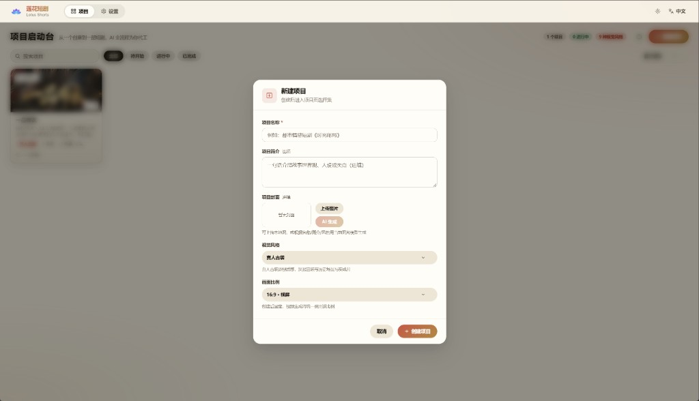
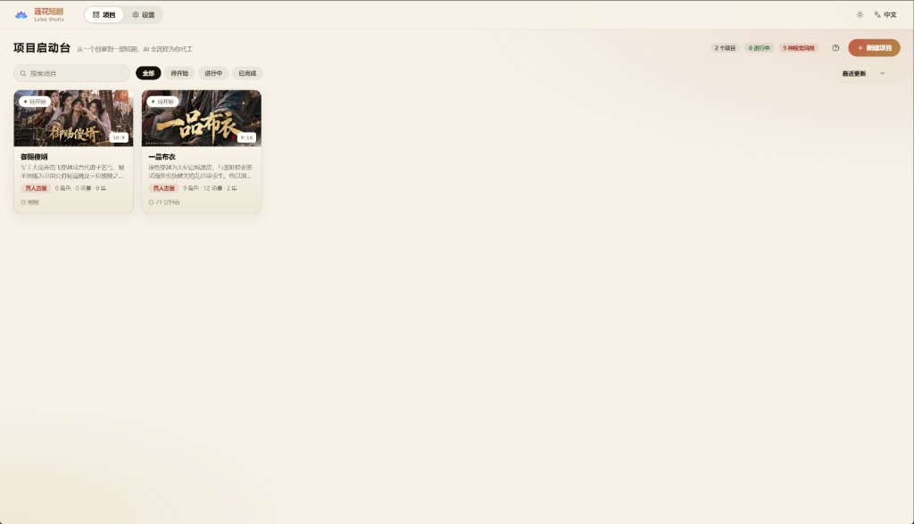
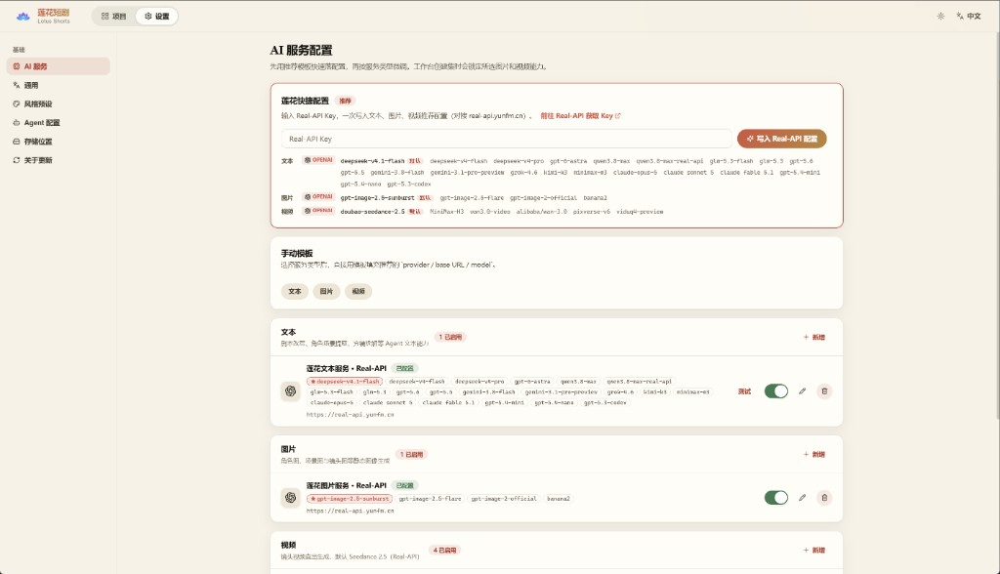
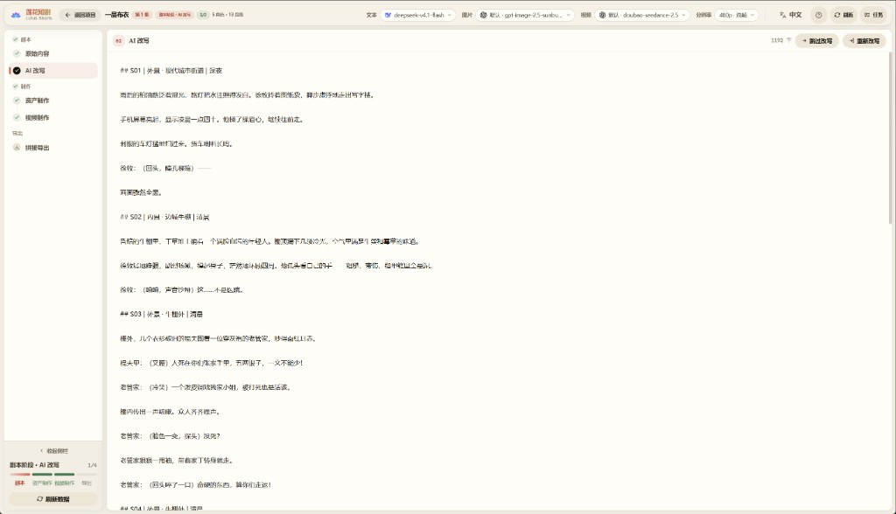
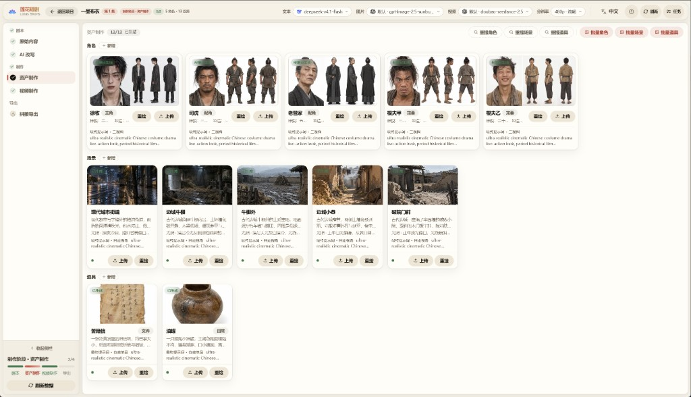
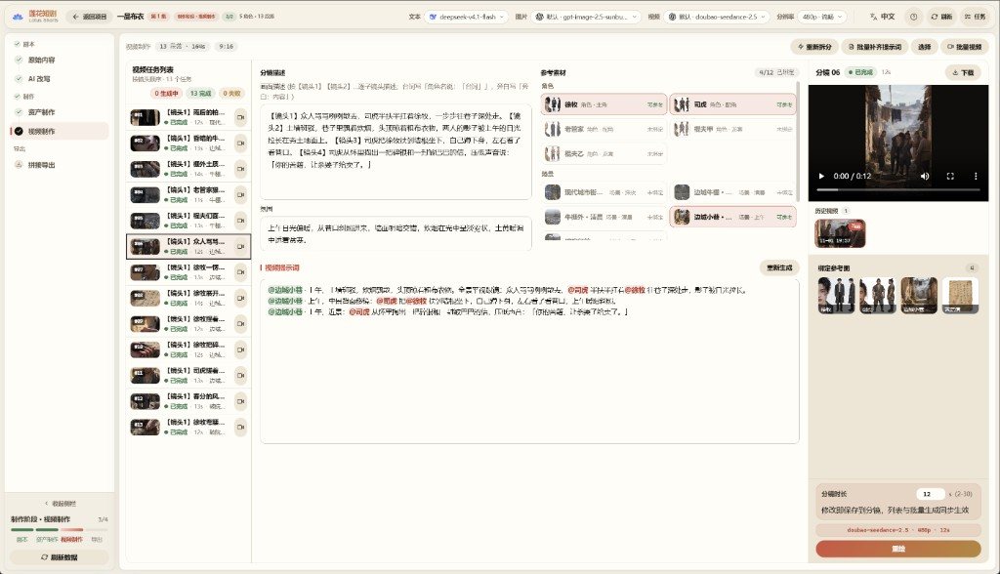
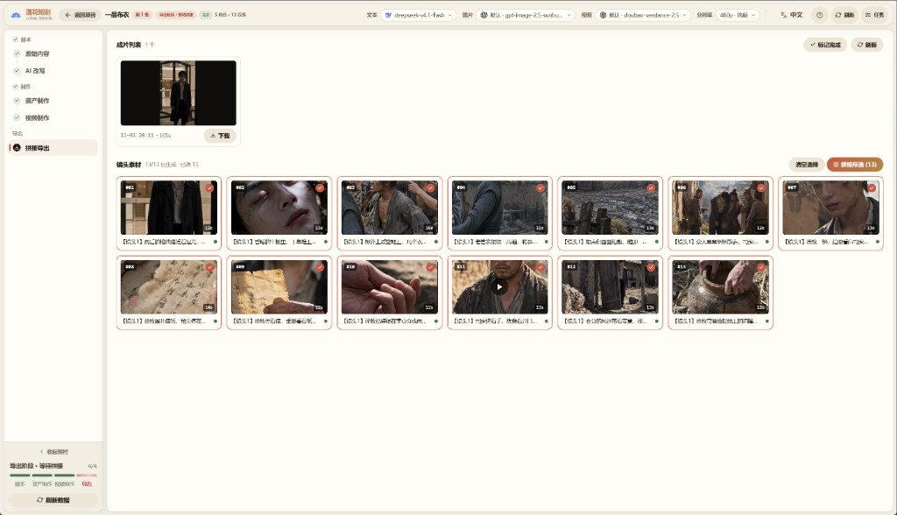

# 🎬 Lotus Shorts - AI Short Drama Generation Platform

<div align="center">

**A full-stack TypeScript platform for automated AI short-drama production**

[](https://nodejs.org)
[](https://vuejs.org)
[](LICENSE)

[中英双语](README.md) | **English** | [简体中文](README.zh-CN.md) | [日本語](README.ja.md) | [한국어](README.ko.md)

[Features](#-features) • [Quick Start](#-quick-start) • [Walkthrough](#-visual-walkthrough) • [Deployment](#-deployment)

<h2>🔑 <a href="https://real-api.yunfm.cn">Get a Real-API Key 👉 Get started</a></h2>

**Text, image, and video AI capabilities — one key unlocks everything**

After deploying, paste the key in "Settings → Lotus Quick Setup" to write three recommended configs in one click
<h3>🌐 <a href="https://real-api.yunfm.cn">Real-API Official Website</a></h3>

</div>

---

## 📖 Overview

Lotus Shorts is an AI-powered short-drama production platform that automates the entire pipeline: script generation, character design, storyboard breakdown, and video compositing.

### 🎯 Core Value

- **🤖 AI-Driven**: LLMs parse scripts and extract characters, scenes, and storyboard information
- **🎨 Intelligent Creation**: AI image generation for character designs and scene backgrounds
- **📹 Video Generation**: Text-to-video and image-to-video models automatically produce storyboard clips
- **🔄 End-to-End Workflow**: A complete pipeline from idea to finished episode

### 🛠️ Architecture

```
frontend/   — Nuxt 3 + Vue 3 + TypeScript (pure CSS, no UI framework)
backend/    — Hono + Drizzle ORM + Mastra AI Agents + better-sqlite3
backend/workspace/skills/ — Agent skill definitions (SKILL.md, editable in the UI)
data/       — Generated assets and the SQLite database
```

---

## ✨ Features

### 🎭 Character Management

- ✅ AI-generated character designs
- ✅ Batch character generation
- ✅ Character image upload and management

### 🎬 Video Tasks

- ✅ Automatic AI video-task generation
- ✅ Scene descriptions and video prompt generation
- ✅ Batch video generation per task

### 🎥 Video Generation

- ✅ Text-to-video generation
- ✅ FFmpeg per-shot compositing and subtitle handling
- ✅ Full-episode stitching and export

### 📦 Asset Management

- ✅ Unified asset library
- ✅ Local storage support
- ✅ Task progress tracking

### 🤖 AI Agents

Four built-in Mastra agents with database-backed configuration and Skill extensions:

| Agent | Role |
|---|---|
| `script_rewriter` | Novel → formatted script rewriting |
| `extractor` | Intelligent extraction and dedup of characters / scenes / props |
| `storyboard_breaker` | Script → storyboard sequence breakdown |
| `prompt_generator` | Image prompts for characters/scenes/props + storyboard video prompts |

### 🌐 Multi-Language UI

The interface ships in **中文 / English / 日本語 / 한국어**, with a global setting for AI-generated content language.

### 🔌 Multi-Provider Support

| Type | Providers |
|---|---|
| **Text** | OpenAI (compatible APIs), Gemini |
| **Image** | OpenAI, Gemini, Volcano Engine |
| **Video** | Volcano Engine Seedance 2.5 (Standard / Fast / Mini), MiniMax H3, Alibaba Bailian Wan 3.0 (Prime / Standard) |

---

## 🚀 Quick Start

### 📋 Requirements

| Software | Version | Notes |
|---|---|---|
| **Node.js** | 20+ | Runtime for frontend and backend |
| **npm** | 9+ | Package manager |

> **Zero-install database**: Bundled SQLite (single file in the project data directory) — no database server required.
> **No FFmpeg install needed**: Binaries ship via the `ffmpeg-static` / `ffprobe-static` npm packages — works out of the box.

### ⚙️ Environment Variables

No config files — everything is set via environment variables (all have defaults; local dev needs zero configuration):

| Variable | Default | Description |
|---|---|---|
| `SQLITE_PATH` | `<repo>/data/lotus.sqlite3` | SQLite database file location |
| `PORT` | `5679` | Backend service port |
| `STORAGE_PATH` | `<repo>/data/static` | Generated-file storage directory |
| `WORKSPACE_PATH` | `backend/workspace` | Agent skills/prompts directory  |
| `FRONTEND_DIST` | `frontend/dist` | Frontend static build directory |
| `FFMPEG_BIN` / `FFPROBE_BIN` | bundled npm binaries | Custom ffmpeg/ffprobe executable paths |
| `PUBLIC_BASE_URL` | — | Public URL Seedance needs to reference local assets (server deployments) |

> **Note**: AI service API keys, base URLs, and model parameters are all configured in the web UI "Settings" page and stored in the database — never in config files or environment variables.

### 📥 Installation

```bash
# Enter the project directory

cd lotus-shorts

# Install backend dependencies
cd backend && npm install

# Install frontend dependencies
cd ../frontend && npm install
```

### 🎯 Running

#### Option 1: Development mode (recommended)

Frontend and backend run separately with hot reload:

```bash
# Terminal 1: backend
cd backend
npm run dev

# Terminal 2: frontend
cd frontend
npm run dev
```

- Frontend: `http://localhost:3013`
- Backend API: `http://localhost:5679/api/v1`
- The frontend automatically proxies `/api` and `/static` to the backend

#### Option 2: Single-service mode

The backend serves both the API and the frontend static files:

```bash
# 1. Build the frontend
cd frontend && npm run generate

# 2. Copy the build output where the backend expects it
#    (generate outputs to .output/public; the backend reads frontend/dist)
cp -r .output/public dist

# 3. Start the backend
cd ../backend && npm start
```

Visit: `http://localhost:5679`

### 🗄️ Database

Bundled SQLite (`better-sqlite3` + WAL mode). Tables are created automatically on first launch (idempotent DDL replay + seed data). Default file: `data/lotus.sqlite3`, overridable via `SQLITE_PATH`.

### 🔑 First Use: Configure AI Services

All AI features (text/image/video) require model services to be configured first — a banner at the top of the page guides you until then:

1. Open the "Settings" page
2. Paste your Real-API key in "Lotus Quick Setup" ([get one at real-api.yunfm.cn](https://real-api.yunfm.cn)) to write three recommended configs (text, image, video) in one click
3. Or add providers one by one via "Manual Templates", with connectivity testing

Once configured, the banner disappears and you can start producing episodes.

---

## 📖 Visual Walkthrough

The complete pipeline from novel to finished episode. The left progress rail always shows where you are.

### Step 1 · Create a Project

On the home page click "New Project", enter a **name**, optionally add a description and cover (upload or AI generate), then pick a **visual style** and **aspect ratio** (16:9 landscape / 9:16 portrait, fixed after creation).

<p align="center">
  
</p>

<p align="center">
  
</p>

### Step 2 · Configure AI Services (first run)

Paste an API key in Settings → "Lotus Quick Setup" to write the three recommended configs at once, or add providers manually. The current model can be switched any time from the top bar (see Step 5).

<p align="center">
  
</p>

### Step 3 · Script Stage

Paste your **source novel** into the workbench, then hit "AI Rewrite" to produce a shooting script — split by episode with scenes and characters annotated. You can switch text models and tone while rewriting.

<p align="center">
  
</p>

### Step 4 · Assets

Run **extraction** on the script to get the character / scene / prop list, then generate a consistent reference image for each (or in batch). These images are injected as reference material when generating videos.

<p align="center">
  
</p>

### Step 5 · Storyboard & Videos

On the "Video Production" page, first run **storyboard breakdown** (AI splits shots and writes video prompts). Then:

- Pick the **video model** in the top bar (Seedance / Wan 3.0 / MiniMax…); resolution and duration tiers follow the model
- Review and tweak each shot's prompt on the right (`@character` references map to reference images automatically)
- Click "Batch Generate Videos"; failed tasks can be retried in one click

<p align="center">
  
</p>

### Step 6 · Merge & Export

Select shots (hover to preview each clip), click "Start Merging" and FFmpeg assembles the full episode — play online or download. Click "Mark Done" when finished to light up the progress rail.

<p align="center">
  
</p>

---

## 📦 Deployment

### 🏭 Server Deployment

```bash
# 1. Build the frontend
cd frontend && npm run generate

# 2. Copy the build output (generate outputs to frontend/.output/public; the backend reads
#    frontend/dist — skip this step and the API works but pages 404)
cp -r .output/public dist && cd ..

# 3. Start the backend
cd backend && npm start
```

Files to upload to the server:

```
backend/                    # backend source + node_modules
backend/workspace/skills/   # Agent skill files
frontend/dist/              # frontend build output
data/                       # data directory (auto-created on first run)
```

#### Nginx Reverse Proxy

```nginx
server {
    listen 80;
    server_name your-domain.com;

    # Max 50MB for reference video/audio uploads
    client_max_body_size 100m;

    # Generated images/videos served straight from disk, bypassing Node:
    # sendfile zero-copy + long-lived caching
    # (files are uuid-named and immutable, so immutable caching is safe)
    location /static/ {
        alias /path/to/lotus-shorts/data/static/;
        sendfile on;
        tcp_nopush on;
        expires 1y;
        add_header Cache-Control "public, immutable";
    }

    location / {
        proxy_pass http://localhost:5679;
        proxy_set_header Host $host;
        proxy_set_header X-Real-IP $remote_addr;
        proxy_set_header X-Forwarded-For $proxy_add_x_forwarded_for;
    }
}
```

> Media loading optimization: the backend automatically generates 400px thumbnails (`*_thumb.webp`) for list pages and extracts poster frames (`*_poster.jpg`) as video covers — the frontend only loads original files when opening the full image or playing. To backfill historical files, run `npm run backfill-artwork` under `backend/`.

---

## 🎨 Tech Stack

### Backend

- **Runtime**: Node.js 20+
- **Web framework**: Hono
- **ORM**: Drizzle ORM + better-sqlite3 (WAL mode)
- **AI Agents**: Mastra + AI SDK (OpenAI compatible)
- **Video processing**: FFmpeg (fluent-ffmpeg + bundled binaries)
- **Image processing**: Sharp

### Frontend

- **Framework**: Nuxt 3 (SPA mode)
- **Language**: Vue 3 + TypeScript
- **Routing**: File-based routing (Vue Router 4)
- **Styling**: Pure CSS + CSS Variables
- **Icons**: Lucide Vue
- **i18n**: vue-i18n (中文 / English / 日本語 / 한국어)

---

## 📝 FAQ

### Q: FFmpeg not installed or not found?

A: No install needed. The project bundles `ffmpeg-static` / `ffprobe-static` binaries. A system `PATH` FFmpeg won't conflict either, and you can point explicitly via `FFMPEG_BIN`/`FFPROBE_BIN`.

### Q: The top of the page says "No model configured"?

A: That's the normal first-deploy guidance. Go to "Settings" and use "Lotus Quick Setup" to paste an API key and write configs in one click, or add providers via "Manual Templates". The banner disappears once text, image, and video all have an enabled config.

### Q: The frontend can't reach the backend API?

A: Check that the backend is running and the port is correct. In dev mode the proxy config lives in `frontend/nuxt.config.ts`.

### Q: Database tables not created?

A: The backend creates all tables automatically on first launch — check the logs to confirm initialization succeeded.

---

## 📄 License

This project is licensed under the **[MIT License](LICENSE)** — free for personal and commercial use (including modification, redistribution, and sale), provided the copyright notice and license text are retained.

Full license text: see [LICENSE](LICENSE).

---

## 💬 WeChat

Scan the QR code to add on WeChat:

<div align="center">
  
</div>

---

## ☕ Sponsor

If this project helps you, you're welcome to sponsor ongoing maintenance via Alipay:

<div align="center">
  
</div>

---

> _"Let AI do the creating with us"_
