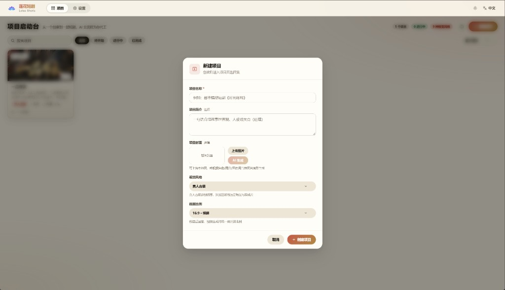
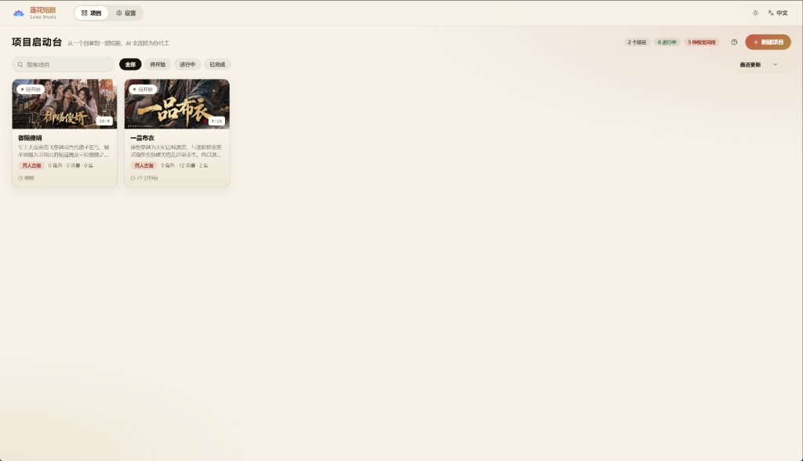
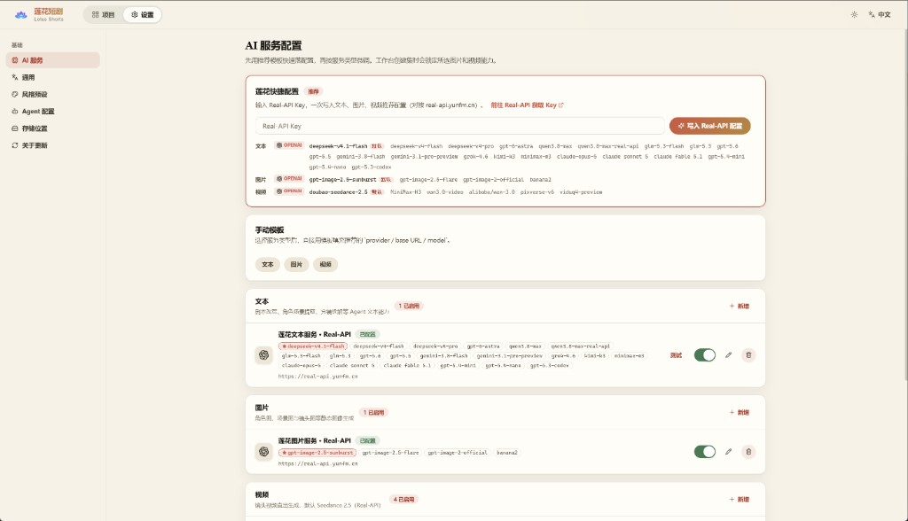
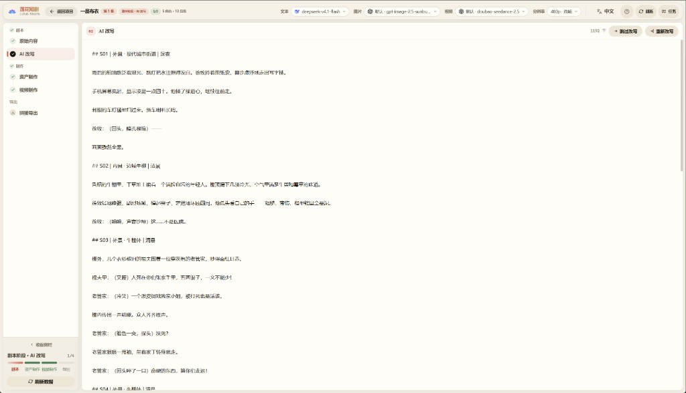
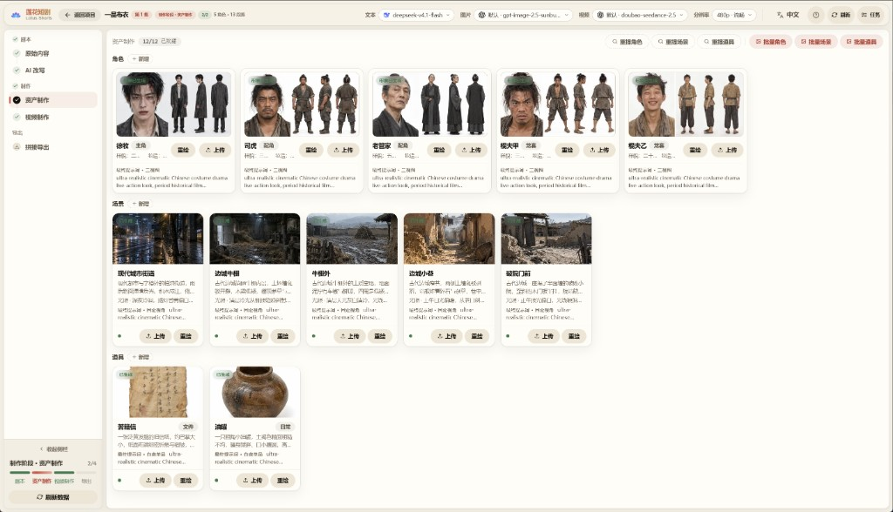
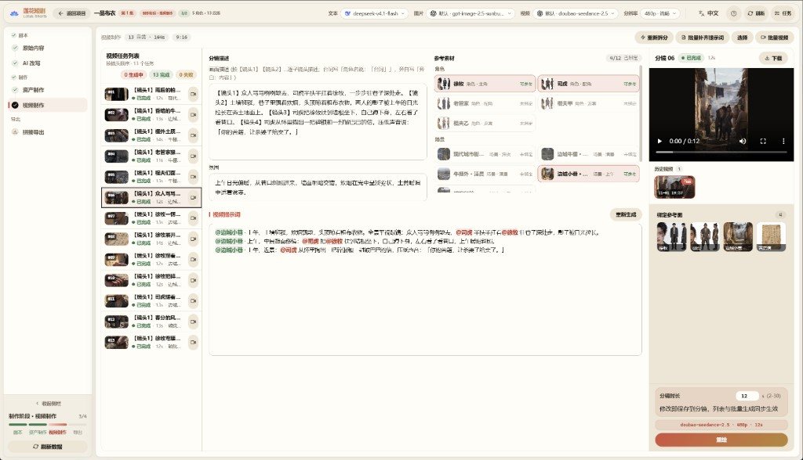
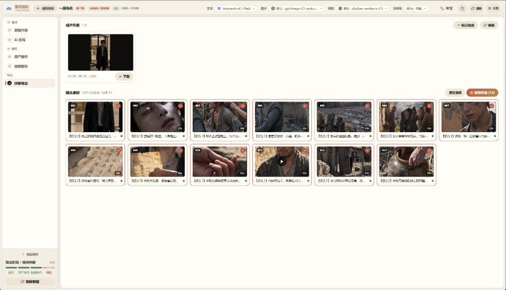

# 🎬 Lotus Shorts - AI ショートドラマ生成プラットフォーム

<div align="center">

**TypeScript フルスタックの AI ショートドラマ自動制作プラットフォーム**

[](https://nodejs.org)
[](https://vuejs.org)
[](LICENSE)

[中英双语](README.md) | [English](README.en.md) | [简体中文](README.zh-CN.md) | **日本語** | [한국어](README.ko.md)

[機能](#-機能) • [クイックスタート](#-クイックスタート) • [チュートリアル](#-チュートリアル画像付き) • [デプロイ](#-デプロイ)

<h2>🔑 <a href="https://real-api.yunfm.cn">Real-API Key を取得 👉 今すぐ見る</a></h2>

**テキスト・画像・動画のすべての AI 機能を、1 つの Key で有効化**

デプロイ後、「設定 → 蓮花クイック設定」に Key を貼るだけで、3 つの推奨設定をワンクリックで書き込み
<h3>🌐 <a href="https://real-api.yunfm.cn">Real-API 公式サイト</a></h3>

</div>

---

## 📖 プロジェクト概要

Lotus Shorts は AI ベースのショートドラマ自動制作プラットフォームです。脚本生成、キャラクターデザイン、分镜制作から動画合成まで、全工程を自動化します。

### 🎯 コアバリュー

- **🤖 AI 駆動**：大規模言語モデルで脚本を解析し、キャラクター・シーン・分镜情報を抽出
- **🎨 インテリジェント制作**：AI 画像生成でキャラクター形象とシーン背景を作成
- **📹 動画生成**：テキスト→動画・画像→動画モデルで分镜動画を自動生成
- **🔄 ワークフロー**：アイデアから完成作品までのショートドラマ制作をワンストップで完結

### 🛠️ 技術アーキテクチャ

```
frontend/   — Nuxt 3 + Vue 3 + TypeScript (純粋 CSS、UI フレームワークなし)
backend/    — Hono + Drizzle ORM + Mastra AI Agents + better-sqlite3
backend/workspace/skills/ — Agent スキル定義 (SKILL.md、UI からオンライン編集可能)
data/       — 生成アセットと SQLite データベース
```

---

## ✨ 機能

### 🎭 キャラクター管理

- ✅ AI によるキャラクター形象生成
- ✅ キャラクターの一括生成
- ✅ キャラクター画像のアップロードと管理

### 🎬 動画タスク

- ✅ AI による動画タスクの自動生成
- ✅ シーン説明と動画プロンプトの生成
- ✅ タスク単位の一括動画生成

### 🎥 動画生成

- ✅ テキスト→動画の自動生成
- ✅ FFmpeg によるショット単位の合成と字幕処理
- ✅ エピソード全体の結合と書き出し

### 📦 アセット管理

- ✅ 素材ライブラリの一元管理
- ✅ ローカルストレージ対応
- ✅ タスク進捗トラッキング

### 🤖 AI Agents

4 つの Mastra Agent を内蔵。データベース設定と Skill 拡張に対応：

| Agent | 役割 |
|---|---|
| `script_rewriter` | 小説 → フォーマット済み脚本へのリライト |
| `extractor` | キャラクター / シーン / 小道具のインテリジェント抽出と重複排除 |
| `storyboard_breaker` | 脚本 → 分镜シーケンスへの分解 |
| `prompt_generator` | キャラクター/シーン/小道具の画像プロンプト + 分镜動画プロンプト生成 |

### 🌐 多言語 UI

インターフェースは **中文 / English / 日本語 / 한국어** を内蔵し、AI 生成コンテンツの言語をグローバルに設定できます。

### 🔌 マルチプロバイダー対応

| タイプ | 対応プロバイダー |
|---|---|
| **テキスト** | OpenAI（互換 API）、Gemini |
| **画像** | OpenAI、Gemini、Volcano Engine |
| **動画** | Volcano Engine Seedance 2.5（Standard / Fast / Mini）、MiniMax H3、Alibaba Bailian Wan 3.0（Prime / Standard） |

---

## 🚀 クイックスタート

### 📋 動作環境

| ソフトウェア | バージョン | 説明 |
|---|---|---|
| **Node.js** | 20+ | フロントエンド・バックエンド実行環境 |
| **npm** | 9+ | パッケージマネージャー |

> **データベース不要**：SQLite 内蔵（プロジェクトのデータディレクトリに単一ファイル）。データベースサーバーのインストールは不要です。
> **FFmpeg 不要**：`ffmpeg-static` / `ffprobe-static` npm パッケージにバイナリを内蔵。すぐに使えます。

### ⚙️ 環境変数

設定ファイルは不要。環境変数で設定します（すべてデフォルト値あり、ローカル開発はゼロ設定で起動可能）：

| 変数 | デフォルト値 | 説明 |
|---|---|---|
| `SQLITE_PATH` | `<リポジトリ>/data/lotus.sqlite3` | SQLite データベースファイルの場所 |
| `PORT` | `5679` | バックエンドサービスのポート |
| `STORAGE_PATH` | `<リポジトリ>/data/static` | 生成ファイルの保存ディレクトリ |
| `WORKSPACE_PATH` | `backend/workspace` | Agent スキル/プロンプトディレクトリ |
| `FRONTEND_DIST` | `frontend/dist` | フロントエンド静的ビルドディレクトリ |
| `FFMPEG_BIN` / `FFPROBE_BIN` | npm 内蔵バイナリ | カスタム ffmpeg/ffprobe の実行ファイルパス |
| `PUBLIC_BASE_URL` | — | Seedance がローカル参照リソースを使う際に必要な公開 URL（サーバーデプロイ用） |

> **説明**：AI サービスの API Key、Base URL、モデルパラメータはすべて Web UI の「設定」ページで設定してデータベースに保存します。設定ファイルや環境変数では管理しません。

### 📥 インストール

```bash
# リポジトリをクローン

cd lotus-shorts

# バックエンドの依存をインストール
cd backend && npm install

# フロントエンドの依存をインストール
cd ../frontend && npm install
```

### 🎯 起動

#### 方法 1：開発モード（推奨）

フロントエンドとバックエンドを分離し、ホットリロード対応：

```bash
# ターミナル 1：バックエンド
cd backend
npm run dev

# ターミナル 2：フロントエンド
cd frontend
npm run dev
```

- フロントエンド：`http://localhost:3013`
- バックエンド API：`http://localhost:5679/api/v1`
- フロントエンドは `/api` と `/static` をバックエンドへ自動プロキシ

#### 方法 2：シングルサービスモード

バックエンドが API とフロントエンド静的ファイルの両方を提供：

```bash
# 1. フロントエンドをビルド
cd frontend && npm run generate

# 2. ビルド成果物をバックエンドが読むディレクトリへコピー
#    （generate の出力は .output/public、バックエンドは frontend/dist を読む）
cp -r .output/public dist

# 3. バックエンドを起動
cd ../backend && npm start
```

アクセス：`http://localhost:5679`

### 🗄️ データベース

SQLite 内蔵（`better-sqlite3` + WAL モード）。初回起動時にテーブルを自動作成（冪等な DDL リプレイ + シードデータ）。デフォルトのファイルは `data/lotus.sqlite3`、`SQLITE_PATH` で変更可能。

### 🔑 初回利用：AI サービスの設定

起動後、すべての AI 機能（テキスト/画像/動画）を使うには、先にモデルサービスの設定が必要です。未設定の場合、ページ上部にバナーで案内されます：

1. 「設定」ページを開く
2. 「蓮花クイック設定」に Real-API Key を貼る（[real-api.yunfm.cn で取得](https://real-api.yunfm.cn)）。テキスト・画像・動画の 3 つの推奨設定をワンクリックで書き込み
3. または「手動テンプレート」でプロバイダーごとに追加。接続テストに対応

設定が完了するとバナーは自動で消え、エピソード制作を開始できます。

---

## 📖 チュートリアル（画像付き）

小説から完成エピソードまでの全工程。左の進捗バーが常に現在のステージを示します。

### ステップ 1 · プロジェクト作成

ホームで「新規プロジェクト」をクリックし、**プロジェクト名**を入力。任意で概要・カバー（アップロードまたは AI 生成）を追加し、**ビジュアルスタイル**と**画面比率**（16:9 横 / 9:16 縦、作成後は変更不可）を選択します。

<p align="center">
  
</p>

<p align="center">
  
</p>

### ステップ 2 · AI サービス設定（初回）

設定ページの「蓮花クイック設定」に API キーを貼り付けると推奨 3 設定を一括書き込み。手動テンプレートでの追加も可能です。使用モデルは上部バーでいつでも切り替えられます（ステップ 5 参照）。

<p align="center">
  
</p>

### ステップ 3 · 脚本ステージ

制作画面に**原文（小説）**を貼り付け、「AI リライト」で撮影用脚本を生成 — エピソード単位の分割とシーン・キャラクターの注記付き。モデルやトーンの切り替えも可能です。

<p align="center">
  
</p>

### ステップ 4 · アセット制作

脚本に**抽出**を実行するとキャラクター / シーン / 小道具の一覧を自動取得。各項目の「イメージ生成」で一貫性のある参照画像を作成します（一括も可）。これらの画像は動画生成時に参照素材として注入されます。

<p align="center">
  
</p>

### ステップ 5 · 絵コンテと動画

「動画制作」ページでまず**絵コンテ分割**を実行（AI がカット割りし動画プロンプトを生成）。その後：

- 上部バーで**動画モデル**を選択（Seedance / Wan 3.0 / MiniMax など）。解像度と尺の選択肢はモデルに連動
- 右側で各カットのプロンプトを確認・調整（`@キャラ名` 参照は自動で参照画像にマッピング）
- 「一括動画生成」でタスク開始。失敗タスクはワンクリックでリトライ

<p align="center">
  
</p>

### ステップ 6 · 連結と書き出し

カットを選択（ホバーで各クリップをプレビュー）し、「連結開始」をクリックすると FFmpeg が完全なエピソードを自動合成。オンライン再生・ダウンロード可能です。完了したら「完了にする」で進捗バーを点灯。

<p align="center">
  
</p>

---

## 📦 デプロイ

### 🏭 サーバーデプロイ

```bash
# 1. フロントエンドをビルド
cd frontend && npm run generate

# 2. ビルド成果物をコピー（generate の出力は frontend/.output/public、バックエンドは
#    frontend/dist を読む。この手順を省くと API は動くがページが 404 になる）
cp -r .output/public dist && cd ..

# 3. バックエンドを起動
cd backend && npm start
```

サーバーにアップロードするファイル：

```
backend/                    # バックエンドソース + node_modules
backend/workspace/skills/   # Agent スキルファイル
frontend/dist/              # フロントエンドビルド成果物
data/                       # データディレクトリ（初回実行時に自動作成）
```

#### Nginx リバースプロキシ

```nginx
server {
    listen 80;
    server_name your-domain.com;

    # 参照動画/音声アップロードは最大 50MB
    client_max_body_size 100m;

    # 生成画像/動画はディスクから直接配信（Node を経由しない）：
    # sendfile ゼロコピー + 長期キャッシュ
    # （ファイルは uuid 命名で内容不変のため immutable キャッシュが安全）
    location /static/ {
        alias /path/to/lotus-shorts/data/static/;
        sendfile on;
        tcp_nopush on;
        expires 1y;
        add_header Cache-Control "public, immutable";
    }

    location / {
        proxy_pass http://localhost:5679;
        proxy_set_header Host $host;
        proxy_set_header X-Real-IP $remote_addr;
        proxy_set_header X-Forwarded-For $proxy_add_x_forwarded_for;
    }
}
```

> メディア読み込みの最適化：画像生成時にバックエンドが 400px サムネイル（`*_thumb.webp`）を自動生成してリストページで使用し、動画はポスターフレーム（`*_poster.jpg`）をカバーとして抽出します。フロントエンドは画像を開く/再生する時だけ元ファイルを読み込みます。過去の既存ファイルは `backend/` で `npm run backfill-artwork` を実行して一括補完できます。

---

## 🎨 技術スタック

### バックエンド

- **ランタイム**：Node.js 20+
- **Web フレームワーク**：Hono
- **ORM**：Drizzle ORM + better-sqlite3（WAL モード）
- **AI Agent**：Mastra + AI SDK（OpenAI 互換）
- **動画処理**：FFmpeg（fluent-ffmpeg + 内蔵バイナリ）
- **画像処理**：Sharp

### フロントエンド

- **フレームワーク**：Nuxt 3（SPA モード）
- **言語**：Vue 3 + TypeScript
- **ルーティング**：ファイルルーティング（Vue Router 4）
- **スタイル**：純粋 CSS + CSS Variables
- **アイコン**：Lucide Vue
- **i18n**：vue-i18n（中文 / English / 日本語 / 한국어）

---

## 📝 よくある質問

### Q: FFmpeg が未インストール/見つからない？

A: インストール不要です。プロジェクトに `ffmpeg-static` / `ffprobe-static` バイナリを内蔵。システム `PATH` の FFmpeg と競合することもありません。`FFMPEG_BIN`/`FFPROBE_BIN` で明示的に指定することも可能です。

### Q: ページ上部に「モデル未設定」と表示される？

A: 初回デプロイ時の正常な案内です。「設定」ページで「蓮花クイック設定」に API Key を貼ってワンクリックで書き込むか、「手動テンプレート」でプロバイダーを追加してください。テキスト・画像・動画の 3 類すべてに有効な設定があるとバナーは自動で消えます。

### Q: フロントエンドがバックエンド API に接続できない？

A: バックエンドが起動しているか、ポートが正しいかを確認してください。開発モードのプロキシ設定は `frontend/nuxt.config.ts` にあります。

### Q: データベーステーブルが作成されない？

A: バックエンドは初回起動時に全テーブルを自動作成します。ログで初期化が成功したか確認してください。

---

## 📄 ライセンス

本プロジェクトは **[MIT](LICENSE)** ライセンスを採用しています。個人・商用利用（改変・再配布・販売を含む）が可能です。利用時は著作権表示とライセンス本文を保持してください。

ライセンス全文は [LICENSE](LICENSE) を参照してください。

---

## 💬 WeChat

QR コードをスキャンして WeChat を追加：

<div align="center">
  
</div>

---

## ☕ スポンサー

本プロジェクトが役に立った場合は、Alipay でのスポンサーにご協力いただけると幸いです：

<div align="center">
  
</div>

---

> _"AI にもっと創造的なことを手伝ってもらおう"_
