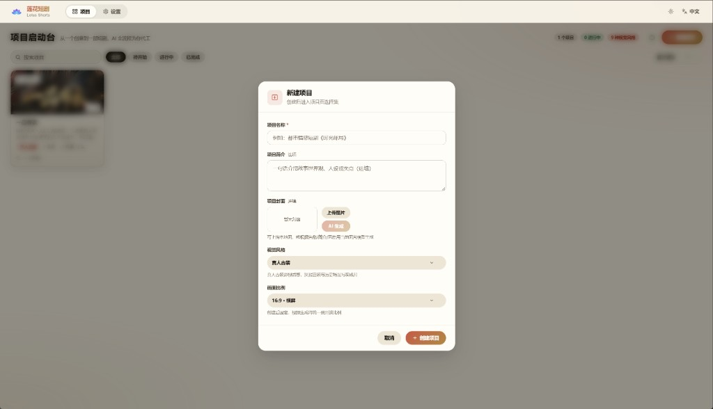
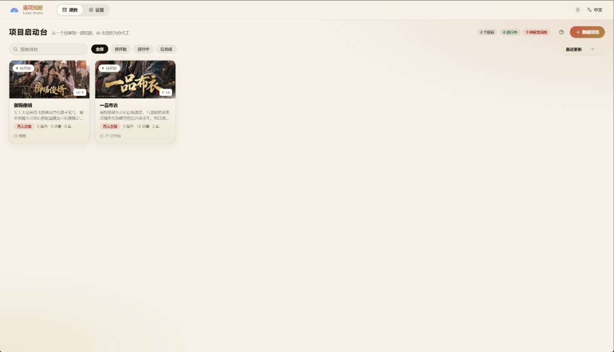
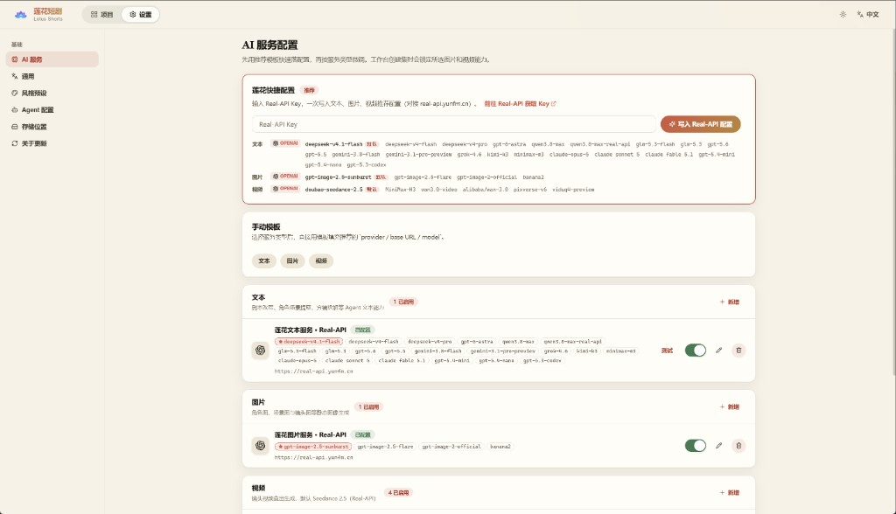
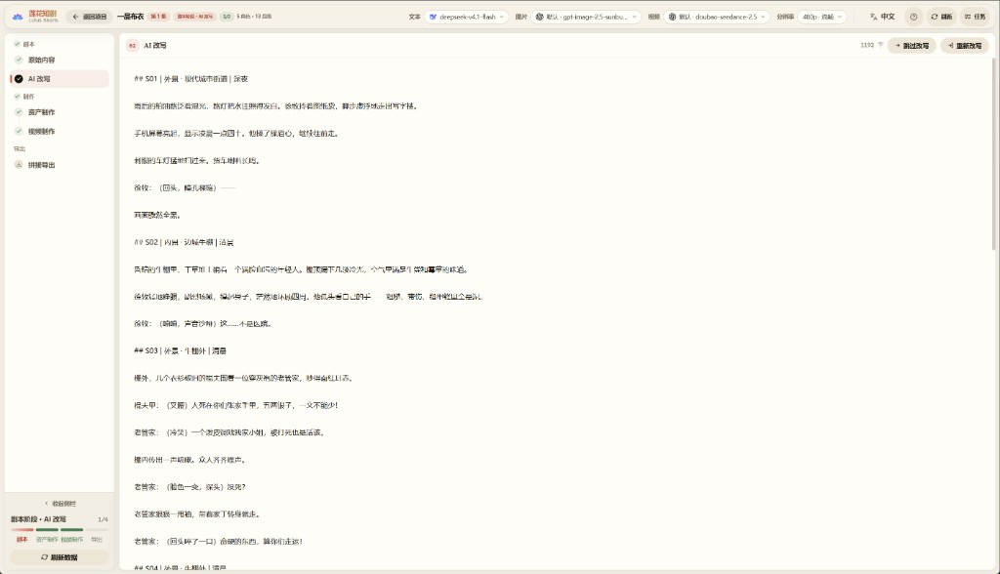
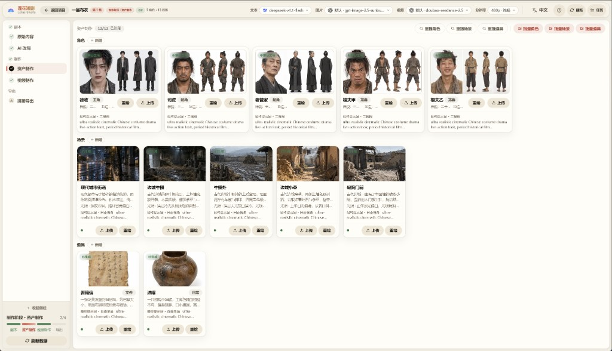
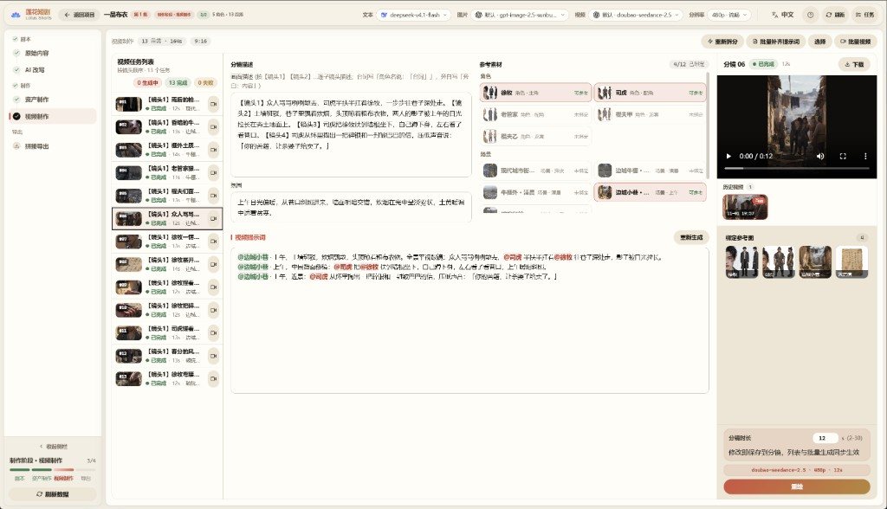
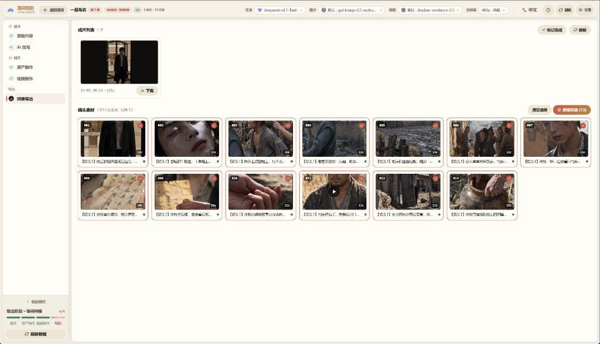

# 🎬 Lotus Shorts - AI 숏드라마 생성 플랫폼

<div align="center">

**TypeScript 풀스택 기반 AI 숏드라마 자동 제작 플랫폼**

[](https://nodejs.org)
[](https://vuejs.org)
[](LICENSE)

[中英双语](README.md) | [English](README.en.md) | [简体中文](README.zh-CN.md) | [日本語](README.ja.md) | **한국어**

[기능](#-기능) • [빠른 시작](#-빠른-시작) • [튜토리얼](#-그림-튜토리얼) • [배포](#-배포)

<h2>🔑 <a href="https://real-api.yunfm.cn">Real-API Key 받기 👉 바로 보기</a></h2>

**텍스트 · 이미지 · 영상 모든 AI 기능, Key 하나로 활성화**

배포 후 「설정 → 莲花快捷 설정」에 Key 를 붙여넣으면 추천 설정 3개가 한 번에 입력됩니다
<h3>🌐 <a href="https://real-api.yunfm.cn">Real-API 공식 사이트</a></h3>

</div>

---

## 📖 프로젝트 소개

Lotus Shorts는 AI 기반 숏드라마 자동 제작 플랫폼으로, 각본 생성, 캐릭터 디자인, 스토리보드 제작부터 영상 합성까지 전 과정을 자동화합니다.

### 🎯 핵심 가치

- **🤖 AI 기반**：대규모 언어 모델로 각본을 분석하여 캐릭터, 장면, 스토리보드 정보를 추출
- **🎨 지능형 창작**：AI 이미지 생성으로 캐릭터 이미지와 장면 배경 제작
- **📹 영상 생성**：텍스트→영상 및 이미지→영상 모델로 스토리보드 영상 자동 생성
- **🔄 워크플로**：아이디어부터 완성 영상까지 숏드라마 제작 전 과정을 한 곳에서 완료

### 🛠️ 기술 아키텍처

```
frontend/   — Nuxt 3 + Vue 3 + TypeScript (순수 CSS, UI 프레임워크 없음)
backend/    — Hono + Drizzle ORM + Mastra AI Agents + better-sqlite3
backend/workspace/skills/ — Agent 스킬 정의 (SKILL.md, UI에서 온라인 편집 가능)
data/       — 생성된 에셋과 SQLite 데이터베이스
```

---

## ✨ 기능

### 🎭 캐릭터 관리

- ✅ AI 캐릭터 이미지 생성
- ✅ 캐릭터 일괄 생성
- ✅ 캐릭터 이미지 업로드 및 관리

### 🎬 영상 작업

- ✅ AI 영상 작업 자동 생성
- ✅ 장면 설명 및 영상 프롬프트 생성
- ✅ 작업별 영상 일괄 생성

### 🎥 영상 생성

- ✅ 텍스트→영상 자동 생성
- ✅ FFmpeg 샷 단위 합성 및 자막 처리
- ✅ 에피소드 전체 병합 및 납출

### 📦 에셋 관리

- ✅ 소재 라이브러리 통합 관리
- ✅ 로컬 스토리지 지원
- ✅ 작업 진행 상황 추적

### 🤖 AI Agents

4개의 Mastra Agent 내장, 데이터베이스 설정과 Skill 확장 지원:

| Agent | 역할 |
|---|---|
| `script_rewriter` | 소설 → 형식화된 각본 리라이팅 |
| `extractor` | 캐릭터 / 장면 / 소품 지능형 추출 및 중복 제거 |
| `storyboard_breaker` | 각본 → 스토리보드 시퀀스 분해 |
| `prompt_generator` | 캐릭터/장면/소품 이미지 프롬프트 + 스토리보드 영상 프롬프트 생성 |

### 🌐 다국어 UI

인터페이스는 **中文 / English / 日本語 / 한국어** 4개 언어를 내장하고, AI 생성 콘텐츠의 언어를 전역으로 설정할 수 있습니다.

### 🔌 멀티 프로바이더 지원

| 유형 | 지원 프로바이더 |
|---|---|
| **텍스트** | OpenAI(호환 API), Gemini |
| **이미지** | OpenAI, Gemini, Volcano Engine |
| **영상** | Volcano Engine Seedance 2.5(Standard / Fast / Mini), MiniMax H3, Alibaba Bailian Wan 3.0(Prime / Standard) |

---

## 🚀 빠른 시작

### 📋 환경 요구 사항

| 소프트웨어 | 버전 | 설명 |
|---|---|---|
| **Node.js** | 20+ | 프런트엔드/백엔드 실행 환경 |
| **npm** | 9+ | 패키지 관리 도구 |

> **데이터베이스 설치 불필요**：SQLite 내장(프로젝트 데이터 디렉터리의 단일 파일)으로 데이터베이스 서버 설치가 필요 없습니다.
> **FFmpeg 설치 불필요**：`ffmpeg-static` / `ffprobe-static` npm 패키지에 바이너리가 내장되어 바로 사용할 수 있습니다.

### ⚙️ 환경 변수

설정 파일 없이 환경 변수로 설정합니다(모두 기본값이 있어 로컬 개발은 무설정으로 시작 가능):

| 변수 | 기본값 | 설명 |
|---|---|---|
| `SQLITE_PATH` | `<저장소>/data/lotus.sqlite3` | SQLite 데이터베이스 파일 위치 |
| `PORT` | `5679` | 백엔드 서비스 포트 |
| `STORAGE_PATH` | `<저장소>/data/static` | 생성 파일 저장 디렉터리 |
| `WORKSPACE_PATH` | `backend/workspace` | Agent 스킬/프롬프트 디렉터리 |
| `FRONTEND_DIST` | `frontend/dist` | 프런트엔드 정적 빌드 디렉터리 |
| `FFMPEG_BIN` / `FFPROBE_BIN` | npm 내장 바이너리 | 사용자 지정 ffmpeg/ffprobe 실행 파일 경로 |
| `PUBLIC_BASE_URL` | — | Seedance가 로컬 참조 리소스를 사용할 때 필요한 공개 주소(서버 배포용) |

> **설명**：AI 서비스의 API Key, Base URL, 모델 파라미터는 모두 웹 UI의 「설정」 페이지에서 설정하여 데이터베이스에 저장합니다. 설정 파일이나 환경 변수로 관리하지 않습니다.

### 📥 설치

```bash
# 저장소 클론

cd lotus-shorts

# 백엔드 의존성 설치
cd backend && npm install

# 프런트엔드 의존성 설치
cd ../frontend && npm install
```

### 🎯 실행

#### 방법 1: 개발 모드(권장)

프런트엔드와 백엔드를 분리하여 핫 리로드 지원:

```bash
# 터미널 1: 백엔드
cd backend
npm run dev

# 터미널 2: 프런트엔드
cd frontend
npm run dev
```

- 프런트엔드 주소: `http://localhost:3013`
- 백엔드 API: `http://localhost:5679/api/v1`
- 프런트엔드가 `/api`와 `/static`을 백엔드로 자동 프록시

#### 방법 2: 단일 서비스 모드

백엔드가 API와 프런트엔드 정적 파일을 모두 제공:

```bash
# 1. 프런트엔드 빌드
cd frontend && npm run generate

# 2. 빌드 산출물을 백엔드가 읽는 디렉터리로 복사
#    (generate 산출물은 .output/public, 백엔드는 frontend/dist를 읽음)
cp -r .output/public dist

# 3. 백엔드 시작
cd ../backend && npm start
```

접속: `http://localhost:5679`

### 🗄️ 데이터베이스

SQLite 내장(`better-sqlite3` + WAL 모드). 최초 시작 시 테이블 자동 생성(멱등 DDL 재생 + 시드 데이터). 기본 파일은 `data/lotus.sqlite3`이며 `SQLITE_PATH`로 변경 가능.

### 🔑 첫 사용: AI 서비스 설정

시작 후 모든 AI 기능(텍스트/이미지/영상)을 사용하려면 먼저 모델 서비스를 설정해야 합니다. 미설정 시 페이지 상단에 배너로 안내합니다:

1. 「설정」 페이지 열기
2. 「莲花快捷 설정」에 Real-API Key 붙여넣기([real-api.yunfm.cn에서 발급](https://real-api.yunfm.cn)). 텍스트, 이미지, 영상 추천 설정 3개가 한 번에 입력됩니다
3. 또는 「수동 템플릿」으로 프로바이더별 추가. 연결 테스트 지원

설정이 완료되면 배너가 자동으로 사라지고 에피소드 제작을 시작할 수 있습니다.

---

## 📖 그림 튜토리얼

소설부터 완성 에피소드까지의 전체 제작 흐름입니다. 왼쪽 진행 표시줄이 항상 현재 단계를 보여줍니다.

### 1단계 · 프로젝트 생성

홈에서 "새 프로젝트"를 클릭하고 **프로젝트 이름**을 입력합니다. 선택적으로 소개·커버(업로드 또는 AI 생성)를 추가한 뒤 **시각 스타일**과 **화면 비율**(16:9 가로 / 9:16 세로, 생성 후 변경 불가)을 선택합니다.

<p align="center">
  
</p>

<p align="center">
  
</p>

### 2단계 · AI 서비스 설정 (최초)

설정 페이지의 "휘바오 빠른 설정"에 API 키를 붙여넣으면 추천 설정 3종을 한 번에 등록합니다. 수동 템플릿으로 직접 추가할 수도 있습니다. 사용 모델은 상단 바에서 언제든 전환 가능합니다(5단계 참고).

<p align="center">
  
</p>

### 3단계 · 대본 단계

제작 화면에 **원문(소설)**을 붙여넣고 "AI 재작성"을 실행하면 촬영용 대본이 생성됩니다 — 에피소드별 분할 및 장면·캐릭터 주석 포함. 모델과 톤을 바꿔가며 재작성할 수 있습니다.

<p align="center">
  
</p>

### 4단계 · 에셋 제작

대본에 **추출**을 실행하면 캐릭터 / 장면 / 소품 목록이 자동 생성됩니다. 각 항목의 "이미지 생성"으로 일관성 있는 참조 이미지를 만들 수 있습니다(일괄 생성 지원). 이 이미지들은 영상 생성 시 참조 소재로 주입됩니다.

<p align="center">
  
</p>

### 5단계 · 스토리보드와 영상

"영상 제작" 페이지에서 먼저 **스토리보드 분할**을 실행하세요(AI가 컷을 나누고 영상 프롬프트 생성). 그 후:

- 상단 바에서 **영상 모델** 선택(Seedance / Wan 3.0 / MiniMax 등). 해상도와 길이 옵션은 모델에 연동됩니다
- 오른쪽에서 각 컷의 프롬프트를 확인·조정(`@캐릭터명` 참조는 자동으로 참조 이미지에 매핑)
- "일괄 영상 생성"으로 작업 시작. 실패한 작업은 원클릭 재시도

<p align="center">
  
</p>

### 6단계 · 병합과 내보내기

컷을 선택(호버로 각 클립 미리보기)하고 "병합 시작"을 누르면 FFmpeg이 완성 에피소드를 자동 합성합니다. 온라인 재생·다운로드 가능. 완료 후 "완료 표시"를 누르면 진행 표시줄이 켜집니다.

<p align="center">
  
</p>

---

## 📦 배포

### 🏭 서버 배포

```bash
# 1. 프런트엔드 빌드
cd frontend && npm run generate

# 2. 빌드 산출물 복사(generate 산출물은 frontend/.output/public, 백엔드는
#    frontend/dist를 읽음. 이 단계를 생략하면 API는 정상이지만 페이지가 404)
cp -r .output/public dist && cd ..

# 3. 백엔드 시작
cd backend && npm start
```

서버에 업로드할 파일:

```
backend/                    # 백엔드 소스 + node_modules
backend/workspace/skills/   # Agent 스킬 파일
frontend/dist/              # 프런트엔드 빌드 산출물
data/                       # 데이터 디렉터리(최초 실행 시 자동 생성)
```

#### Nginx 리버스 프록시

```nginx
server {
    listen 80;
    server_name your-domain.com;

    # 참조 영상/오디오 업로드 최대 50MB
    client_max_body_size 100m;

    # 생성된 이미지/영상은 디스크에서 직접 서빙(Node를 거치지 않음):
    # sendfile 제로 카피 + 장기 캐시
    # (파일은 uuid 명명, 내용 불변이므로 immutable 캐시 안전)
    location /static/ {
        alias /path/to/lotus-shorts/data/static/;
        sendfile on;
        tcp_nopush on;
        expires 1y;
        add_header Cache-Control "public, immutable";
    }

    location / {
        proxy_pass http://localhost:5679;
        proxy_set_header Host $host;
        proxy_set_header X-Real-IP $remote_addr;
        proxy_set_header X-Forwarded-For $proxy_add_x_forwarded_for;
    }
}
```

> 미디어 로딩 최적화: 이미지 생성 시 백엔드가 목록 페이지용 400px 썸네일(`*_thumb.webp`)을 자동 생성하고, 영상은 포스터 프레임(`*_poster.jpg`)을 커버로 추출합니다. 프런트엔드는 큰 이미지를 열거나 재생할 때만 원본 파일을 로드합니다. 기존 파일은 `backend/`에서 `npm run backfill-artwork`를 실행해 일괄 보완할 수 있습니다.

---

## 🎨 기술 스택

### 백엔드

- **런타임**: Node.js 20+
- **웹 프레임워크**: Hono
- **ORM**: Drizzle ORM + better-sqlite3(WAL 모드)
- **AI Agent**: Mastra + AI SDK(OpenAI 호환)
- **영상 처리**: FFmpeg(fluent-ffmpeg + 내장 바이너리)
- **이미지 처리**: Sharp

### 프런트엔드

- **프레임워크**: Nuxt 3(SPA 모드)
- **언어**: Vue 3 + TypeScript
- **라우팅**: 파일 라우팅(Vue Router 4)
- **스타일**: 순수 CSS + CSS Variables
- **아이콘**: Lucide Vue
- **i18n**: vue-i18n(中文 / English / 日本語 / 한국어)

---

## 📝 자주 묻는 질문

### Q: FFmpeg가 설치되지 않았거나 찾을 수 없다고 나옵니다?

A: 설치할 필요가 없습니다. 프로젝트에 `ffmpeg-static` / `ffprobe-static` 바이너리가 내장되어 있습니다. 시스템 `PATH`의 FFmpeg와 충돌하지 않으며, `FFMPEG_BIN`/`FFPROBE_BIN`으로 명시적으로 지정할 수도 있습니다.

### Q: 페이지 상단에 「모델 미설정」이 표시됩니다?

A: 정상적인 첫 배포 안내입니다. 「설정」 페이지에서 「莲花快捷 설정」에 API Key를 붙여넣어 한 번에 입력하거나, 「수동 템플릿」으로 프로바이더를 추가하세요. 텍스트, 이미지, 영상 3가지 모두에 활성화된 설정이 있으면 배너가 자동으로 사라집니다.

### Q: 프런트엔드가 백엔드 API에 연결되지 않습니다?

A: 백엔드가 시작되었는지, 포트가 올바른지 확인하세요. 개발 모드의 프록시 설정은 `frontend/nuxt.config.ts`에 있습니다.

### Q: 데이터베이스 테이블이 생성되지 않았습니다?

A: 백엔드는 최초 시작 시 모든 테이블을 자동으로 생성합니다. 로그에서 초기화 성공 여부를 확인하세요.

---

## 📄 라이선스

이 프로젝트는 **[MIT](LICENSE)** 라이선스를 채택합니다. 개인 및 상업적 사용(수정·재배포·판매 포함)이 가능하며, 사용 시 저작권 고지와 라이선스 전문을 유지해야 합니다.

라이선스 전문은 [LICENSE](LICENSE)를 참조하세요.

---

## 💬 WeChat

QR 코드를 스캔하여 WeChat을 추가하세요:

<div align="center">
  
</div>

---

## ☕ 후원

이 프로젝트가 도움이 되었다면 Alipay로 후원해 주시면 지속적인 유지보수에 큰 힘이 됩니다:

<div align="center">
  
</div>

---

> _"AI가 더 창의적인 일을 돕게 하자"_
