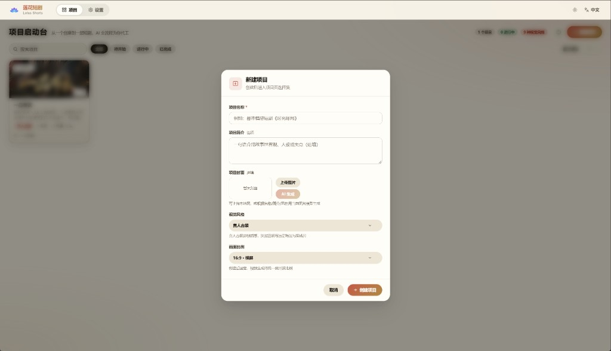
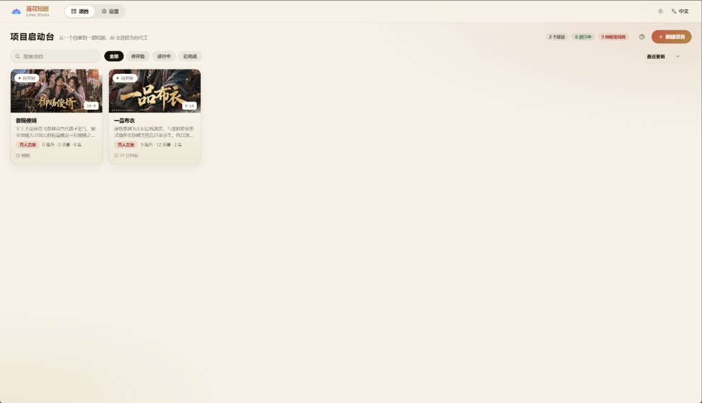
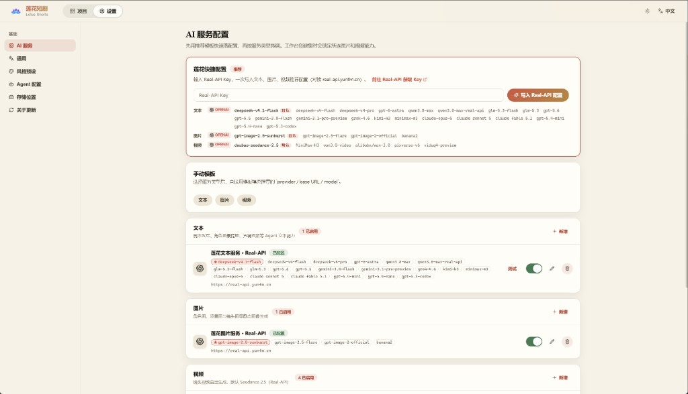
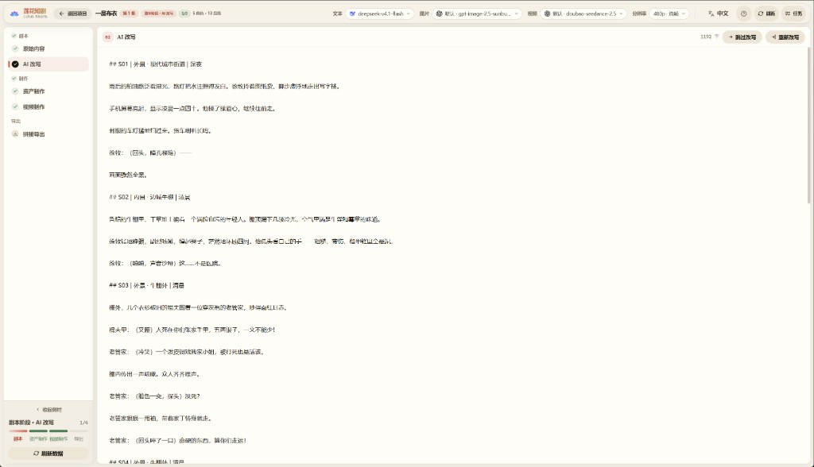
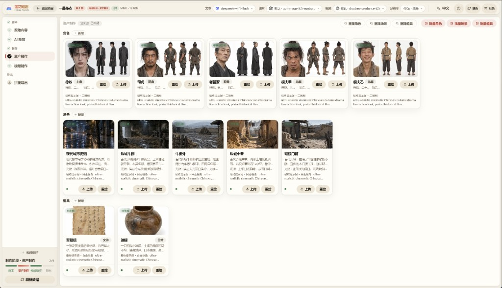
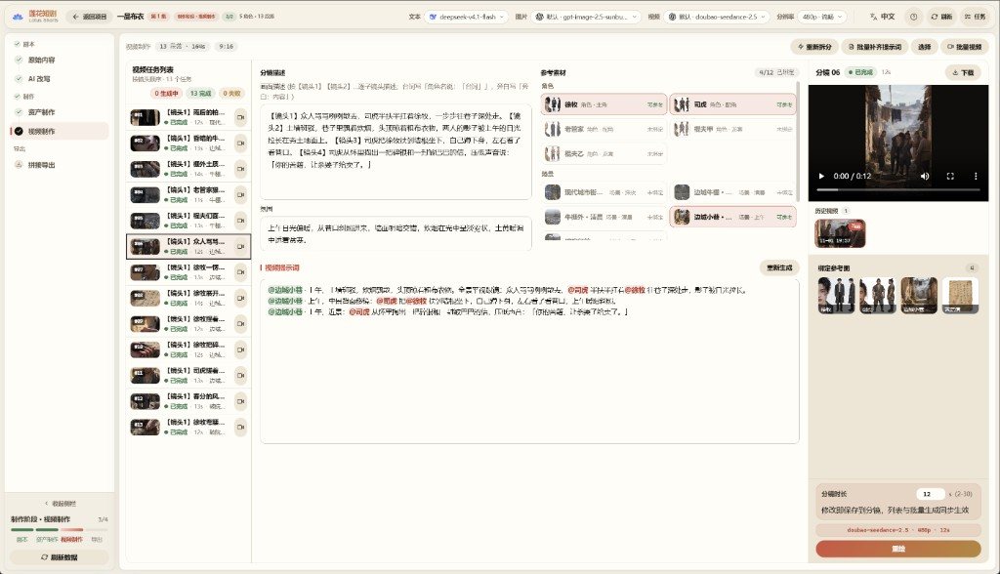
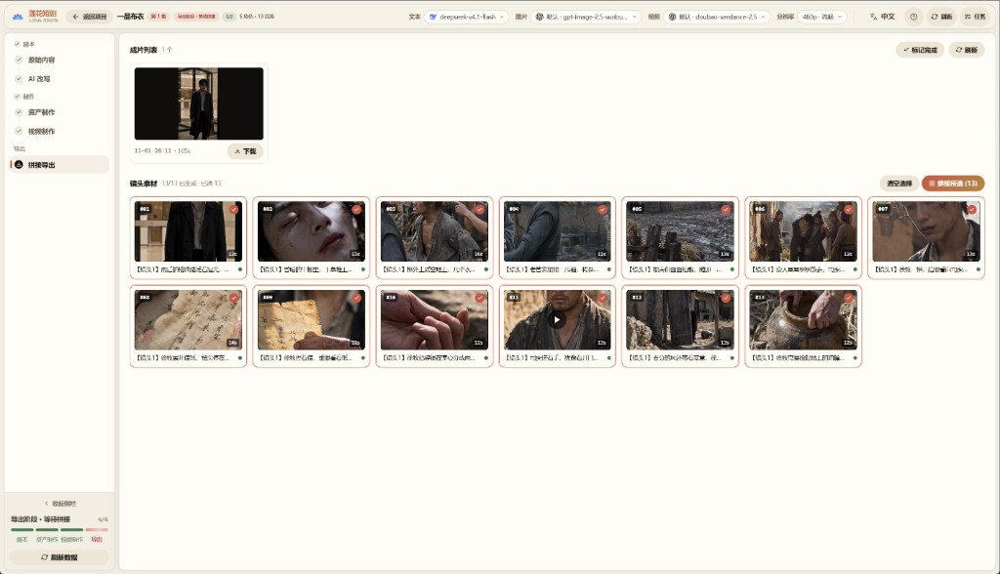

# 🎬 Lotus Shorts — AI 短剧生成平台 / AI Short Drama Generation Platform

<div align="center">

**基于 TypeScript 全栈的 AI 短剧自动化生产平台**<br>
**A full-stack TypeScript platform for automated AI short-drama production**

[](https://nodejs.org)
[](https://vuejs.org)
[](LICENSE)

**中英双语 / Bilingual** | [简体中文](README.zh-CN.md) | [English](README.en.md) | [日本語](README.ja.md) | [한국어](README.ko.md)

<p>
  <a href="https://real-api.yunfm.cn">
    
  </a>
</p>

**文本 · 图片 · 视频全部 AI 能力，一个 Key 即可开通**<br>
**Text, image, and video AI capabilities — one key unlocks everything**

部署完成后，在「设置 → 莲花快捷配置」粘贴 Key，一键写入三条推荐配置。<br>
After deploying, paste the key in "Settings → Lotus Quick Setup" to write three recommended configs in one click.
<p>
  <a href="https://real-api.yunfm.cn">
    
  </a>
</p>

</div>

---

## 📖 项目简介 / Overview

Lotus Shorts 是一个基于 AI 的短剧自动化生产平台，实现从剧本生成、角色设计、分镜制作到视频合成的全流程自动化。<br>
Lotus Shorts is an AI-powered short-drama production platform that automates the entire pipeline: script generation, character design, storyboard breakdown, and video compositing.

### 🎯 核心价值 / Core Value

- **🤖 AI 驱动**：使用大语言模型解析剧本，提取角色、场景和分镜信息<br>
  **🤖 AI-Driven**: LLMs parse scripts and extract characters, scenes, and storyboard information

- **🎨 智能创作**：AI 绘图生成角色形象和场景背景<br>
  **🎨 Intelligent Creation**: AI image generation for character designs and scene backgrounds

- **📹 视频生成**：基于文生视频和图生视频模型自动生成分镜视频<br>
  **📹 Video Generation**: Text-to-video and image-to-video models automatically produce storyboard clips

- **🔄 工作流**：完整的短剧制作工作流，从创意到成片一站式完成<br>
  **🔄 End-to-End Workflow**: A complete pipeline from idea to finished episode

### 🛠️ 技术架构 / Architecture

```
frontend/   — Nuxt 3 + Vue 3 + TypeScript（纯 CSS，无 UI 框架 / pure CSS, no UI framework）
backend/    — Hono + Drizzle ORM + Mastra AI Agents + better-sqlite3
backend/workspace/skills/ — Agent 技能定义，支持界面在线编辑 / Agent skill definitions (SKILL.md), editable in the UI
data/       — 生成资源文件与 SQLite 数据库 / Generated assets and the SQLite database
```

---

## ✨ 功能特性 / Features

### 🎭 角色管理 / Character Management

- ✅ AI 生成角色形象<br>
  ✅ AI-generated character designs

- ✅ 批量角色生成<br>
  ✅ Batch character generation

- ✅ 角色图片上传和管理<br>
  ✅ Character image upload and management

### 🎬 视频任务 / Video Tasks

- ✅ AI 自动生成视频任务<br>
  ✅ Automatic AI video-task generation

- ✅ 场景描述和视频提示词生成<br>
  ✅ Scene descriptions and video prompt generation

- ✅ 按任务批量生成视频<br>
  ✅ Batch video generation per task

### 🎥 视频生成 / Video Generation

- ✅ 文生视频自动生成<br>
  ✅ Text-to-video generation

- ✅ FFmpeg 单镜头合成与字幕处理<br>
  ✅ FFmpeg per-shot compositing and subtitle handling

- ✅ 整集拼接导出<br>
  ✅ Full-episode stitching and export

### 📦 资源管理 / Asset Management

- ✅ 素材库统一管理<br>
  ✅ Unified asset library

- ✅ 本地存储支持<br>
  ✅ Local storage support

- ✅ 任务进度追踪<br>
  ✅ Task progress tracking

### 🤖 AI Agents

内置 4 个 Mastra Agent，支持数据库配置和 Skill 扩展：<br>
Four built-in Mastra agents with database-backed configuration and Skill extensions:

| Agent |职责<br>Role|
|---|---|
| `script_rewriter` |小说 → 格式化剧本改写<br>Novel → formatted script rewriting|
| `extractor` |角色 / 场景 / 道具智能提取与去重<br>Intelligent extraction and dedup of characters / scenes / props|
| `storyboard_breaker` |剧本 → 分镜序列拆解<br>Script → storyboard sequence breakdown|
| `prompt_generator` |角色/场景/道具图片提示词 + 分镜视频提示词生成<br>Image prompts for characters/scenes/props + storyboard video prompts|

### 🌐 多语言界面 / Multi-Language UI

界面内置 **中文 / English / 日本語 / 한국어** 四种语言，并可全局设置 AI 生成内容的语言。<br>
The interface ships in **中文 / English / 日本語 / 한국어**, with a global setting for AI-generated content language.

### 🔌 多厂商适配 / Multi-Provider Support

|类型<br>Type|支持厂商<br>Providers|
|---|---|
|**文本**<br>**Text**|OpenAI(兼容接口)、Gemini<br>OpenAI (compatible APIs), Gemini|
|**图片**<br>**Image**|OpenAI、Gemini、火山引擎<br>OpenAI, Gemini, Volcano Engine|
|**视频**<br>**Video**|火山引擎 Seedance 2.5(标准 / Fast / Mini)、MiniMax H3、阿里云百炼 Wan 3.0 (Prime / 标准)<br>Volcano Engine Seedance 2.5 (Standard / Fast / Mini), MiniMax H3, Alibaba Bailian Wan 3.0 (Prime / Standard)|

---

## 🚀 快速开始 / Quick Start

### 📋 环境要求 / Requirements

|软件<br>Software|版本要求<br>Version|说明<br>Notes|
|---|---|---|
| **Node.js** | 20+ |前后端运行环境<br>Runtime for frontend and backend|
| **npm** | 9+ |包管理工具<br>Package manager|

> **数据库零安装**：内置 SQLite（单文件，随项目数据目录存放），无需安装任何数据库服务。<br>
> **Zero-install database**: Bundled SQLite (single file in the project data directory) — no database server required.

> **FFmpeg 无需安装**：项目通过 `ffmpeg-static` / `ffprobe-static` npm 包内置二进制，开箱即用。<br>
> **No FFmpeg install needed**: Binaries ship via the `ffmpeg-static` / `ffprobe-static` npm packages — works out of the box.

### ⚙️ 环境变量 / Environment Variables

无需配置文件，通过环境变量设置（均有默认值，本地开发可零配置启动）：<br>
No config files — everything is set via environment variables (all have defaults; local dev needs zero configuration):

|变量<br>Variable|默认值<br>Default|说明<br>Description|
|---|---|---|
| `SQLITE_PATH` |`<仓库根>/data/lotus.sqlite3`<br>`<repo>/data/lotus.sqlite3`|SQLite 数据库文件位置<br>SQLite database file location|
| `PORT` | `5679` |后端服务端口<br>Backend service port|
| `STORAGE_PATH` |`<仓库根>/data/static`<br>`<repo>/data/static`|生成文件存储目录<br>Generated-file storage directory|
| `WORKSPACE_PATH` | `backend/workspace` |Agent 技能/提示词目录<br>Agent skills/prompts directory |
| `FRONTEND_DIST` | `frontend/dist` |前端静态产物目录<br>Frontend static build directory|
| `FFMPEG_BIN` / `FFPROBE_BIN` |npm 内置二进制<br>bundled npm binaries|自定义 ffmpeg/ffprobe 可执行文件路径<br>Custom ffmpeg/ffprobe executable paths|
| `PUBLIC_BASE_URL` | — |Seedance 引用本地参考资源时所需的公网地址（服务器部署用）<br>Public URL Seedance needs to reference local assets (server deployments)|

> **说明**：AI 服务的 API Key、Base URL 和模型参数全部在 Web 界面的「设置」页配置并入库，不在配置文件/环境变量中维护。<br>
> **Note**: AI service API keys, base URLs, and model parameters are all configured in the web UI "Settings" page and stored in the database — never in config files or environment variables.

### 📥 安装依赖 / Installation

```bash
# 克隆项目 / Clone the repository

cd lotus-shorts

# 安装后端依赖 / Install backend dependencies
cd backend && npm install

# 安装前端依赖 / Install frontend dependencies
cd ../frontend && npm install
```

### 🎯 启动项目 / Running

#### 方式一：开发模式（推荐） / Option 1: Development mode (recommended)

前后端分离，支持热重载：<br>
Frontend and backend run separately with hot reload:

```bash
# 终端1：启动后端 / Terminal 1: backend
cd backend
npm run dev

# 终端2：启动前端 / Terminal 2: frontend
cd frontend
npm run dev
```

- 前端地址: `http://localhost:3013`<br>
  Frontend: `http://localhost:3013`

- 后端 API: `http://localhost:5679/api/v1`<br>
  Backend API: `http://localhost:5679/api/v1`

- 前端自动代理 `/api` 和 `/static` 到后端<br>
  The frontend automatically proxies `/api` and `/static` to the backend

#### 方式二：单服务模式 / Option 2: Single-service mode

后端同时提供 API 和前端静态文件：<br>
The backend serves both the API and the frontend static files:

```bash
# 1. 构建前端 / Build the frontend
cd frontend && npm run generate

# 2. 复制构建产物到后端读取的目录 / Copy the build output where the backend expects it
# generate 产物在 .output/public，后端只读取 frontend/dist
# generate outputs to .output/public; the backend reads frontend/dist
cp -r .output/public dist

# 3. 启动后端 / Start the backend
cd ../backend && npm start
```

访问: `http://localhost:5679`<br>
Visit: `http://localhost:5679`

### 🗄️ 数据库 / Database

内置 SQLite（`better-sqlite3` + WAL 模式），数据库表在首次启动时自动创建（幂等重放 DDL 与种子数据），默认文件位于 `data/lotus.sqlite3`，可通过 `SQLITE_PATH` 重定向。<br>
Bundled SQLite (`better-sqlite3` + WAL mode). Tables are created automatically on first launch (idempotent DDL replay + seed data). Default file: `data/lotus.sqlite3`, overridable via `SQLITE_PATH`.

### 🔑 首次使用：配置 AI 服务 / First Use: Configure AI Services

启动后所有 AI 功能（文本/生图/视频）都需要先配置模型服务，未配置时页面顶部会有横幅引导：<br>
All AI features (text/image/video) require model services to be configured first — a banner at the top of the page guides you until then:

1. 打开「设置」页<br>
   Open the "Settings" page

2. 在「莲花快捷配置」中粘贴 Real-API Key（[前往 real-api.yunfm.cn 获取](https://real-api.yunfm.cn)），一键写入文本、图片、视频三条推荐配置<br>
   Paste your Real-API key in "Lotus Quick Setup" ([get one at real-api.yunfm.cn](https://real-api.yunfm.cn)) to write three recommended configs (text, image, video) in one click

3. 或使用「手动模板」按厂商逐个添加，支持连通性测试<br>
   Or add providers one by one via "Manual Templates", with connectivity testing

配置完成横幅自动消失，即可开始创建剧集生产。<br>
Once configured, the banner disappears and you can start producing episodes.

---

## 📖 图文教程 / Visual Walkthrough

从小说到成片的完整制作流程。左侧进度栏始终标示当前所处阶段，跟着走即可。<br>
The complete pipeline from novel to finished episode. The left progress rail always shows where you are.

### 第 1 步 · 创建项目 / Step 1 · Create a Project

首页点「新建项目」，填写**项目名称**；可选填写简介、上传或 AI 生成封面；再选择**视觉风格**与**画面比例**（横屏 16:9 / 竖屏 9:16，创建后不可改）。<br>
On the home page click "New Project", enter a **name**, optionally add a description and cover (upload or AI generate), then pick a **visual style** and **aspect ratio** (16:9 landscape / 9:16 portrait, fixed after creation).

<p align="center">
  
</p>

项目卡片即项目列表，随时点入续作：

<p align="center">
  
</p>

### 第 2 步 · 配置 AI 服务（首次） / Step 2 · Configure AI Services (first run)

设置页「莲花快捷配置」粘贴 API Key 一键写入三条推荐配置；或用「手动模板」按厂商自选模型（顶栏可随时切换当前模型，见第 5 步）。<br>
Paste an API key in Settings → "Lotus Quick Setup" to write the three recommended configs at once, or add providers manually. The current model can be switched any time from the top bar (see Step 5).

<p align="center">
  
</p>

### 第 3 步 · 剧本阶段 / Step 3 · Script Stage

进入剧集工作台，先粘贴**原始内容**（小说文本），再点「AI 改写」生成拍摄剧本——按集拆分、标注场景与角色，改写时可换文本模型、调语气。满意后「保存并进入制作」。<br>
Paste your **source novel** into the workbench, then hit "AI Rewrite" to produce a shooting script — split by episode with scenes and characters annotated. You can switch text models and tone while rewriting.

<p align="center">
  
</p>

### 第 4 步 · 资产制作 / Step 4 · Assets

对剧本执行**提取**，自动获得角色 / 场景 / 道具清单；逐个点「生成形象」产出一致性参考图（也可批量）。生成的资产图会在后续生视频时作为参考素材注入。<br>
Run **extraction** on the script to get the character / scene / prop list, then generate a consistent reference image for each (or in batch). These images are injected as reference material when generating videos.

<p align="center">
  
</p>

### 第 5 步 · 分镜与视频 / Step 5 · Storyboard & Videos

「视频制作」页先**拆分分镜**（AI 按镜头节奏切分并生成视频提示词），然后：<br>
On the "Video Production" page, first run **storyboard breakdown** (AI splits shots and writes video prompts). Then:

- 顶栏选择本次使用的**视频模型**（Seedance / Wan 3.0 / MiniMax…），分辨率与时长档位随之联动<br>
  Pick the **video model** in the top bar (Seedance / Wan 3.0 / MiniMax…); resolution and duration tiers follow the model

- 右侧检查 / 微调每个分镜的提示词（`@角色名` 自动映射参考图）<br>
  Review and tweak each shot's prompt on the right (`@character` references map to reference images automatically)

- 点「批量生成视频」发起任务，失败任务可一键「重试失败」<br>
  Click "Batch Generate Videos"; failed tasks can be retried in one click

<p align="center">
  
</p>

### 第 6 步 · 拼接导出 / Step 6 · Merge & Export

勾选镜头（悬停可预览单个镜头视频），点「开始拼接」，FFmpeg 自动合成为完整剧集成片，支持在线播放与下载。完成后点「标记完成」，左侧进度栏点亮。<br>
Select shots (hover to preview each clip), click "Start Merging" and FFmpeg assembles the full episode — play online or download. Click "Mark Done" when finished to light up the progress rail.

<p align="center">
  
</p>

---

## 📦 部署指南 / Deployment

### 🏭 服务器部署方式 / Server Deployment

```bash
# 1. 构建前端 / Build the frontend
cd frontend && npm run generate

# 2. 复制构建产物 / Copy the build output
# generate 产物在 frontend/.output/public，后端只读取 frontend/dist，缺此步 API 正常但页面 404
# generate outputs to frontend/.output/public; the backend reads frontend/dist — skip this step and the API works but pages 404
cp -r .output/public dist && cd ..

# 3. 启动后端 / Start the backend
cd backend && npm start
```

需要上传到服务器的文件：<br>
Files to upload to the server:

```
backend/                    # 后端源码 + node_modules / backend source + node_modules
backend/workspace/skills/   # Agent 技能文件 / Agent skill files
frontend/dist/              # 前端构建产物 / frontend build output
data/                       # 数据目录（首次运行自动创建） / data directory (auto-created on first run)
```

#### Nginx 反向代理 / Nginx Reverse Proxy

```nginx
server {
    listen 80;
    server_name your-domain.com;

    # 参考视频/音频上传最大 50MB / Max 50MB for reference video/audio uploads
    client_max_body_size 100m;

    # 生成的图片/视频直连磁盘，不经过 Node / Generated images/videos served straight from disk, bypassing Node
    # sendfile 零拷贝 + 长缓存 / sendfile zero-copy + long-lived caching
    # 产物按 uuid 命名、内容不变，可安全 immutable 缓存 / Files are uuid-named and immutable, so immutable caching is safe
    location /static/ {
        alias /path/to/lotus-shorts/data/static/;
        sendfile on;
        tcp_nopush on;
        expires 1y;
        add_header Cache-Control "public, immutable";
    }

    location / {
        proxy_pass http://localhost:5679;
        proxy_set_header Host $host;
        proxy_set_header X-Real-IP $remote_addr;
        proxy_set_header X-Forwarded-For $proxy_add_x_forwarded_for;
    }
}
```

> 媒体加载优化：生成图片时后端会自动产出 400px 缩略图（`*_thumb.webp`）供列表页加载，视频会抽取海报帧（`*_poster.jpg`）作为封面，前端仅在点开大图/播放时才加载原文件。历史存量文件可在 `backend/` 下执行 `npm run backfill-artwork` 一次性补齐。<br>
> Media loading optimization: the backend automatically generates 400px thumbnails (`*_thumb.webp`) for list pages and extracts poster frames (`*_poster.jpg`) as video covers — the frontend only loads original files when opening the full image or playing. To backfill historical files, run `npm run backfill-artwork` under `backend/`.

---

## 🎨 技术栈 / Tech Stack

### 后端 / Backend

- **运行时**: Node.js 20+<br>
  **Runtime**: Node.js 20+

- **Web 框架**: Hono<br>
  **Web framework**: Hono

- **ORM**: Drizzle ORM + better-sqlite3（WAL 模式）<br>
  **ORM**: Drizzle ORM + better-sqlite3 (WAL mode)

- **AI Agent**: Mastra + AI SDK (OpenAI compatible)<br>
  **AI Agents**: Mastra + AI SDK (OpenAI compatible)

- **视频处理**: FFmpeg (fluent-ffmpeg + 内置二进制)<br>
  **Video processing**: FFmpeg (fluent-ffmpeg + bundled binaries)

- **图片处理**: Sharp<br>
  **Image processing**: Sharp

### 前端 / Frontend

- **框架**: Nuxt 3 (SPA 模式)<br>
  **Framework**: Nuxt 3 (SPA mode)

- **语言**: Vue 3 + TypeScript<br>
  **Language**: Vue 3 + TypeScript

- **路由**: 文件路由 (Vue Router 4)<br>
  **Routing**: File-based routing (Vue Router 4)

- **样式**: 纯 CSS + CSS Variables<br>
  **Styling**: Pure CSS + CSS Variables

- **图标**: Lucide Vue<br>
  **Icons**: Lucide Vue

- **国际化**: vue-i18n（中文 / English / 日本語 / 한국어）<br>
  **i18n**: vue-i18n (中文 / English / 日本語 / 한국어)

---

## 📝 常见问题 / FAQ

### Q: FFmpeg 未安装或找不到？ / Q: FFmpeg not installed or not found?

A: 无需安装。项目内置 `ffmpeg-static` / `ffprobe-static` 二进制。系统 `PATH` 中的 FFmpeg 也不会冲突，也可通过 `FFMPEG_BIN`/`FFPROBE_BIN` 显式指定。<br>
A: No install needed. The project bundles `ffmpeg-static` / `ffprobe-static` binaries. A system `PATH` FFmpeg won't conflict either, and you can point explicitly via `FFMPEG_BIN`/`FFPROBE_BIN`.

### Q: 页面顶部提示「尚未配置模型」？ / Q: The top of the page says "No model configured"?

A: 这是正常的首次部署引导。前往「设置」页，用「莲花快捷配置」粘贴 API Key 一键写入，或通过「手动模板」按厂商添加。文本、图片、视频三类均有启用中的配置后横幅自动消失。<br>
A: That's the normal first-deploy guidance. Go to "Settings" and use "Lotus Quick Setup" to paste an API key and write configs in one click, or add providers via "Manual Templates". The banner disappears once text, image, and video all have an enabled config.

### Q: 前端无法连接后端 API？ / Q: The frontend can't reach the backend API?

A: 检查后端是否启动，端口是否正确。开发模式下前端代理配置在 `frontend/nuxt.config.ts`。<br>
A: Check that the backend is running and the port is correct. In dev mode the proxy config lives in `frontend/nuxt.config.ts`.

### Q: 数据库表未创建？ / Q: Database tables not created?

A: 后端会在首次启动时自动创建所有表，检查日志确认初始化是否成功。<br>
A: The backend creates all tables automatically on first launch — check the logs to confirm initialization succeeded.

---

## 📄 许可证 / License

本项目采用 **[MIT](LICENSE)** 许可证，允许个人与商业用途（含修改、再分发与销售），使用时请保留版权声明与许可证文本。<br>
This project is licensed under the **[MIT License](LICENSE)** — free for personal and commercial use (including modification, redistribution, and sale), provided the copyright notice and license text are retained.

许可证全文见 [LICENSE](LICENSE)。<br>
Full license text: see [LICENSE](LICENSE).

---

## 💬 微信 / WeChat

扫码添加微信：<br>
Scan the QR code to add on WeChat:

<div align="center">
  
</div>

---

## ☕ 赞助 / Sponsor

如果本项目对你有帮助，欢迎通过支付宝赞助支持持续维护：<br>
If this project helps you, you're welcome to sponsor ongoing maintenance via Alipay:

<div align="center">
  
</div>

---

> _"让 AI 帮我们做更有创造力的事"_<br>
> _"Let AI do the creating with us"_
