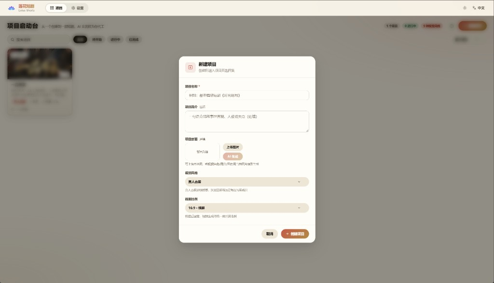
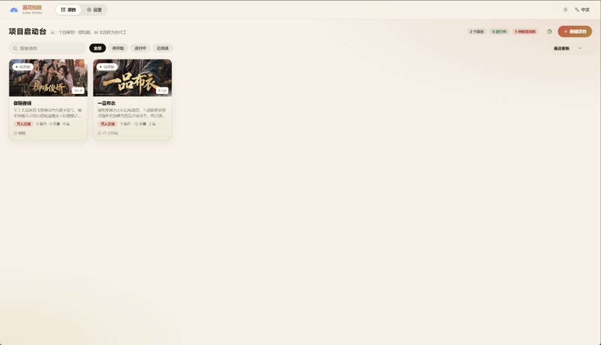
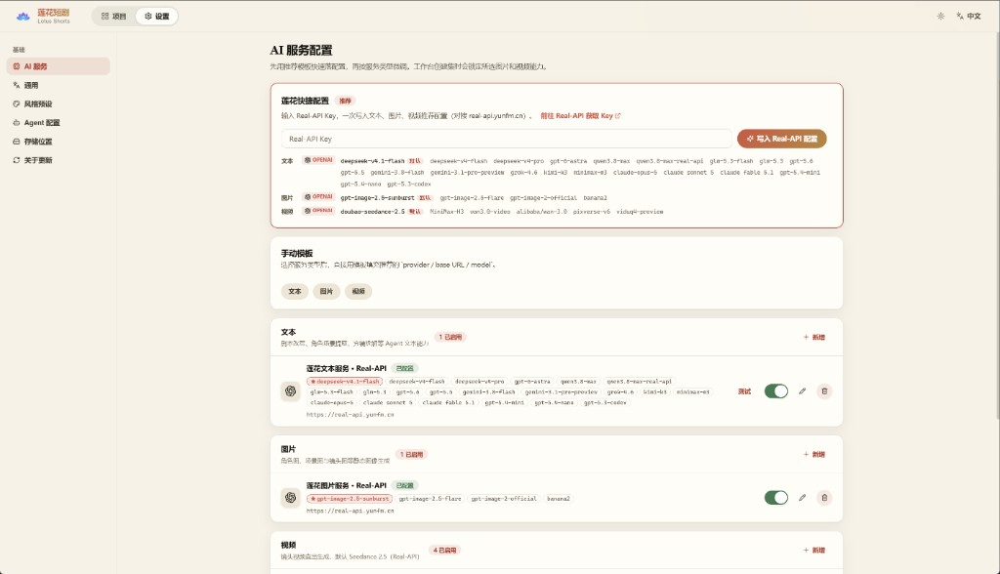
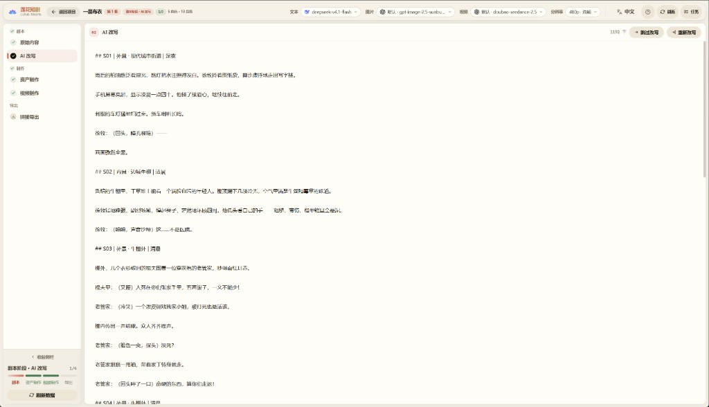
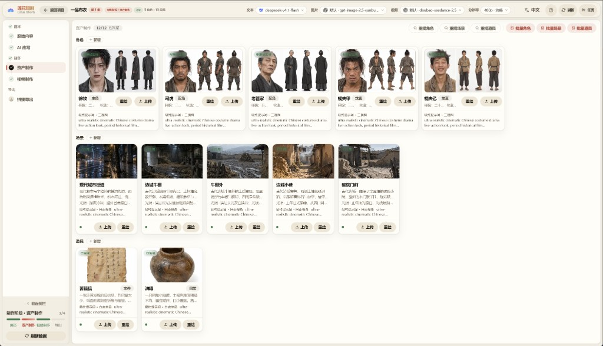
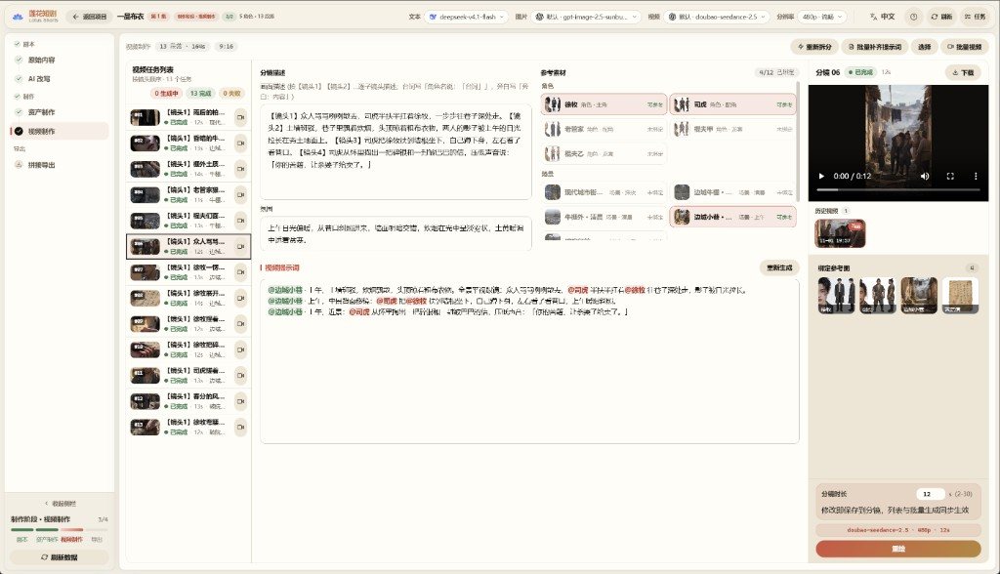
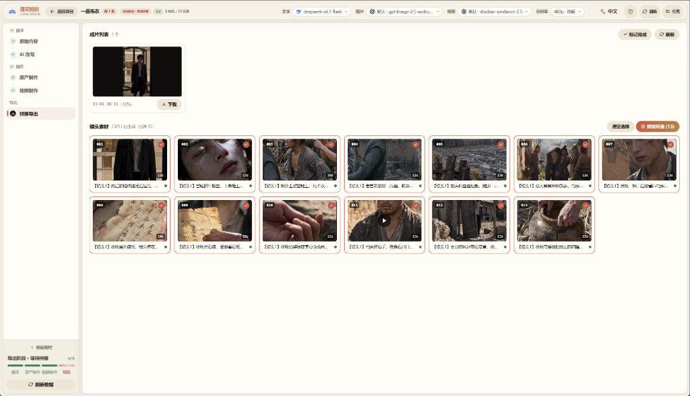

# 🎬 莲花短剧（Lotus Shorts）- AI 短剧生成平台

<div align="center">

**基于 TypeScript 全栈的 AI 短剧自动化生产平台**

[](https://nodejs.org)
[](https://vuejs.org)
[](LICENSE)

[中英双语](README.md) | **简体中文** | [English](README.en.md) | [日本語](README.ja.md) | [한국어](README.ko.md)

[功能特性](#-功能特性) • [快速开始](#-快速开始) • [图文教程](#-图文教程) • [部署指南](#-部署指南)

<h2>🔑 <a href="https://real-api.yunfm.cn">获取 Real-API Key 👉 立即查看</a></h2>

**文本 · 图片 · 视频全部 AI 能力，一个 Key 即可开通**

部署完成后在「设置 → 莲花快捷配置」粘贴 Key，一键写入三条推荐配置，开箱即用
<h3>🌐 <a href="https://real-api.yunfm.cn">Real-API 官网</a></h3>

</div>

---

## 📖 项目简介

莲花短剧（Lotus Shorts）是一个基于 AI 的短剧自动化生产平台，实现从剧本生成、角色设计、分镜制作到视频合成的全流程自动化。

### 🎯 核心价值

- **🤖 AI 驱动**：使用大语言模型解析剧本，提取角色、场景和分镜信息
- **🎨 智能创作**：AI 绘图生成角色形象和场景背景
- **📹 视频生成**：基于文生视频和图生视频模型自动生成分镜视频
- **🔄 工作流**：完整的短剧制作工作流，从创意到成片一站式完成

### 🛠️ 技术架构

```
frontend/   — Nuxt 3 + Vue 3 + TypeScript (纯 CSS，无 UI 框架)
backend/    — Hono + Drizzle ORM + Mastra AI Agents + better-sqlite3
backend/workspace/skills/ — Agent 技能定义 (SKILL.md，支持界面在线编辑)
data/       — 生成资源文件与 SQLite 数据库
```

---

## ✨ 功能特性

### 🎭 角色管理

- ✅ AI 生成角色形象
- ✅ 批量角色生成
- ✅ 角色图片上传和管理

### 🎬 视频任务

- ✅ AI 自动生成视频任务
- ✅ 场景描述和视频提示词生成
- ✅ 按任务批量生成视频

### 🎥 视频生成

- ✅ 文生视频自动生成
- ✅ FFmpeg 单镜头合成与字幕处理
- ✅ 整集拼接导出

### 📦 资源管理

- ✅ 素材库统一管理
- ✅ 本地存储支持
- ✅ 任务进度追踪

### 🤖 AI Agents

内置 4 个 Mastra Agent，支持数据库配置和 Skill 扩展：

| Agent | 职责 |
|---|---|
| `script_rewriter` | 小说 → 格式化剧本改写 |
| `extractor` | 角色 / 场景 / 道具智能提取与去重 |
| `storyboard_breaker` | 剧本 → 分镜序列拆解 |
| `prompt_generator` | 角色/场景/道具图片提示词 + 分镜视频提示词生成 |

### 🌐 多语言界面

界面内置 **中文 / English / 日本語 / 한국어** 四种语言，并可全局设置 AI 生成内容的语言。

### 🔌 多厂商适配

| 类型 | 支持厂商 |
|---|---|
| **文本** | OpenAI(兼容接口)、Gemini |
| **图片** | OpenAI、Gemini、火山引擎 |
| **视频** | 火山引擎 Seedance 2.5(标准 / Fast / Mini)、MiniMax H3、阿里云百炼 Wan 3.0 (Prime / 标准) |

---

## 🚀 快速开始

### 📋 环境要求

| 软件 | 版本要求 | 说明 |
|---|---|---|
| **Node.js** | 20+ | 前后端运行环境 |
| **npm** | 9+ | 包管理工具 |

> **数据库零安装**：内置 SQLite（单文件，随项目数据目录存放），无需安装任何数据库服务。
> **FFmpeg 无需安装**：项目通过 `ffmpeg-static` / `ffprobe-static` npm 包内置二进制，开箱即用。

### ⚙️ 环境变量

无需配置文件，通过环境变量设置（均有默认值，本地开发可零配置启动）：

| 变量 | 默认值 | 说明 |
|---|---|---|
| `SQLITE_PATH` | `<仓库根>/data/lotus.sqlite3` | SQLite 数据库文件位置 |
| `PORT` | `5679` | 后端服务端口 |
| `STORAGE_PATH` | `<仓库根>/data/static` | 生成文件存储目录 |
| `WORKSPACE_PATH` | `backend/workspace` | Agent 技能/提示词目录 |
| `FRONTEND_DIST` | `frontend/dist` | 前端静态产物目录 |
| `FFMPEG_BIN` / `FFPROBE_BIN` | npm 内置二进制 | 自定义 ffmpeg/ffprobe 可执行文件路径 |
| `PUBLIC_BASE_URL` | — | Seedance 引用本地参考资源时所需的公网地址（服务器部署用） |

> **说明**：AI 服务的 API Key、Base URL 和模型参数全部在 Web 界面的「设置」页配置并入库，不在配置文件/环境变量中维护。

### 📥 安装依赖

```bash
# 进入项目目录

cd lotus-shorts

# 安装后端依赖
cd backend && npm install

# 安装前端依赖
cd ../frontend && npm install
```

### 🎯 启动项目

#### 方式一：开发模式（推荐）

前后端分离，支持热重载：

```bash
# 终端1：启动后端
cd backend
npm run dev

# 终端2：启动前端
cd frontend
npm run dev
```

- 前端地址: `http://localhost:3013`
- 后端 API: `http://localhost:5679/api/v1`
- 前端自动代理 `/api` 和 `/static` 到后端

#### 方式二：单服务模式

后端同时提供 API 和前端静态文件：

```bash
# 1. 构建前端
cd frontend && npm run generate

# 2. 复制构建产物到后端读取的目录（generate 产物在 .output/public，后端只读取 frontend/dist）
cp -r .output/public dist

# 3. 启动后端
cd ../backend && npm start
```

访问: `http://localhost:5679`

### 🗄️ 数据库

内置 SQLite（`better-sqlite3` + WAL 模式），数据库表在首次启动时自动创建（幂等重放 DDL 与种子数据），默认文件位于 `data/lotus.sqlite3`，可通过 `SQLITE_PATH` 重定向。

### 🔑 首次使用：配置 AI 服务

启动后所有 AI 功能（文本/生图/视频）都需要先配置模型服务，未配置时页面顶部会有横幅引导：

1. 打开「设置」页
2. 在「莲花快捷配置」中粘贴 Real-API Key（[前往 real-api.yunfm.cn 获取](https://real-api.yunfm.cn)），一键写入文本、图片、视频三条推荐配置
3. 或使用「手动模板」按厂商逐个添加，支持连通性测试

配置完成横幅自动消失，即可开始创建剧集生产。

---

## 📖 图文教程

从小说到成片的完整制作流程。左侧进度栏始终标示当前所处阶段，跟着走即可。

### 第 1 步 · 创建项目

首页点「新建项目」，填写**项目名称**；可选填写简介、上传或 AI 生成封面；再选择**视觉风格**与**画面比例**（横屏 16:9 / 竖屏 9:16，创建后不可改）。

<p align="center">
  
</p>

项目卡片即项目列表，随时点入续作：

<p align="center">
  
</p>

### 第 2 步 · 配置 AI 服务（首次）

设置页「莲花快捷配置」粘贴 API Key 一键写入三条推荐配置；或用「手动模板」按厂商自选模型（顶栏可随时切换当前模型，见第 5 步）。

<p align="center">
  
</p>

### 第 3 步 · 剧本阶段

进入剧集工作台，先粘贴**原始内容**（小说文本），再点「AI 改写」生成拍摄剧本——按集拆分、标注场景与角色，改写时可换文本模型、调语气。满意后「保存并进入制作」。

<p align="center">
  
</p>

### 第 4 步 · 资产制作

对剧本执行**提取**，自动获得角色 / 场景 / 道具清单；逐个点「生成形象」产出一致性参考图（也可批量）。生成的资产图会在后续生视频时作为参考素材注入。

<p align="center">
  
</p>

### 第 5 步 · 分镜与视频

「视频制作」页先**拆分分镜**（AI 按镜头节奏切分并生成视频提示词），然后：

- 顶栏选择本次使用的**视频模型**（Seedance / Wan 3.0 / MiniMax…），分辨率与时长档位随之联动
- 右侧检查 / 微调每个分镜的提示词（`@角色名` 自动映射参考图）
- 点「批量生成视频」发起任务，失败任务可一键「重试失败」

<p align="center">
  
</p>

### 第 6 步 · 拼接导出

勾选镜头（悬停可预览单个镜头视频），点「开始拼接」，FFmpeg 自动合成为完整剧集成片，支持在线播放与下载。完成后点「标记完成」，左侧进度栏点亮。

<p align="center">
  
</p>

---

## 📦 部署指南

### 🏭 服务器部署方式

```bash
# 1. 构建前端
cd frontend && npm run generate

# 2. 复制构建产物（generate 产物在 frontend/.output/public，后端只读取 frontend/dist，缺此步 API 正常但页面 404）
cp -r .output/public dist && cd ..

# 3. 启动后端
cd backend && npm start
```

需要上传到服务器的文件：

```
backend/                    # 后端源码 + node_modules
backend/workspace/skills/   # Agent 技能文件
frontend/dist/              # 前端构建产物
data/                       # 数据目录（首次运行自动创建）
```

#### Nginx 反向代理

```nginx
server {
    listen 80;
    server_name your-domain.com;

    # 参考视频/音频上传最大 50MB
    client_max_body_size 100m;

    # 生成的图片/视频直连磁盘，不经过 Node：sendfile 零拷贝 + 长缓存
    # （产物按 uuid 命名、内容不变，可安全 immutable 缓存）
    location /static/ {
        alias /path/to/lotus-shorts/data/static/;
        sendfile on;
        tcp_nopush on;
        expires 1y;
        add_header Cache-Control "public, immutable";
    }

    location / {
        proxy_pass http://localhost:5679;
        proxy_set_header Host $host;
        proxy_set_header X-Real-IP $remote_addr;
        proxy_set_header X-Forwarded-For $proxy_add_x_forwarded_for;
    }
}
```

> 媒体加载优化：生成图片时后端会自动产出 400px 缩略图（`*_thumb.webp`）供列表页加载，视频会抽取海报帧（`*_poster.jpg`）作为封面，前端仅在点开大图/播放时才加载原文件。历史存量文件可在 `backend/` 下执行 `npm run backfill-artwork` 一次性补齐。

---

## 🎨 技术栈

### 后端

- **运行时**: Node.js 20+
- **Web 框架**: Hono
- **ORM**: Drizzle ORM + better-sqlite3（WAL 模式）
- **AI Agent**: Mastra + AI SDK (OpenAI compatible)
- **视频处理**: FFmpeg (fluent-ffmpeg + 内置二进制)
- **图片处理**: Sharp

### 前端

- **框架**: Nuxt 3 (SPA 模式)
- **语言**: Vue 3 + TypeScript
- **路由**: 文件路由 (Vue Router 4)
- **样式**: 纯 CSS + CSS Variables
- **图标**: Lucide Vue
- **国际化**: vue-i18n（中文 / English / 日本語 / 한국어）

---

## 📝 常见问题

### Q: FFmpeg 未安装或找不到？

A: 无需安装。项目内置 `ffmpeg-static` / `ffprobe-static` 二进制。系统 `PATH` 中的 FFmpeg 也不会冲突，也可通过 `FFMPEG_BIN`/`FFPROBE_BIN` 显式指定。

### Q: 页面顶部提示「尚未配置模型」？

A: 这是正常的首次部署引导。前往「设置」页，用「莲花快捷配置」粘贴 API Key 一键写入，或通过「手动模板」按厂商添加。文本、图片、视频三类均有启用中的配置后横幅自动消失。

### Q: 前端无法连接后端 API？

A: 检查后端是否启动，端口是否正确。开发模式下前端代理配置在 `frontend/nuxt.config.ts`。

### Q: 数据库表未创建？

A: 后端会在首次启动时自动创建所有表，检查日志确认初始化是否成功。

---

## 📄 许可证

本项目采用 **[MIT](LICENSE)** 许可证，允许个人与商业用途（含修改、再分发与销售），使用时请保留版权声明与许可证文本。

许可证全文见 [LICENSE](LICENSE)。

---

## 💬 微信

扫码添加微信：

<div align="center">
  
</div>

---

## ☕ 赞助

如果本项目对你有帮助，欢迎通过支付宝赞助支持持续维护：

<div align="center">
  
</div>

---

> _"让 AI 帮我们做更有创造力的事"_
